# Factorio RTS

**Factorio as a StarCraft-style real-time strategy (RTS) game, with a real Factorio production economy, grown into a Rise of Nations-style mini-state.** You command from a free camera instead of walking an engineer: box-select units, right-click to move and attack, set control groups and fire abilities. Your army comes out of a factory you build yourself: extractors on finite ore patches, smelters, belts and inserters, factories and labs, forward hubs with their own logistic networks and haulers that carry goods between them. **Skirmish** is a 15 to 30 minute match on a generated arena against 1 to 3 AI commanders. **Nation** grows that into a small state on a world of up to 4096×4096 tiles: you found cities, feed and house their people, link them by rail, keep a treasury, trade, go to war for goals, capture cities and race 1 to 5 AI nations through three ages to a Space Program launch.

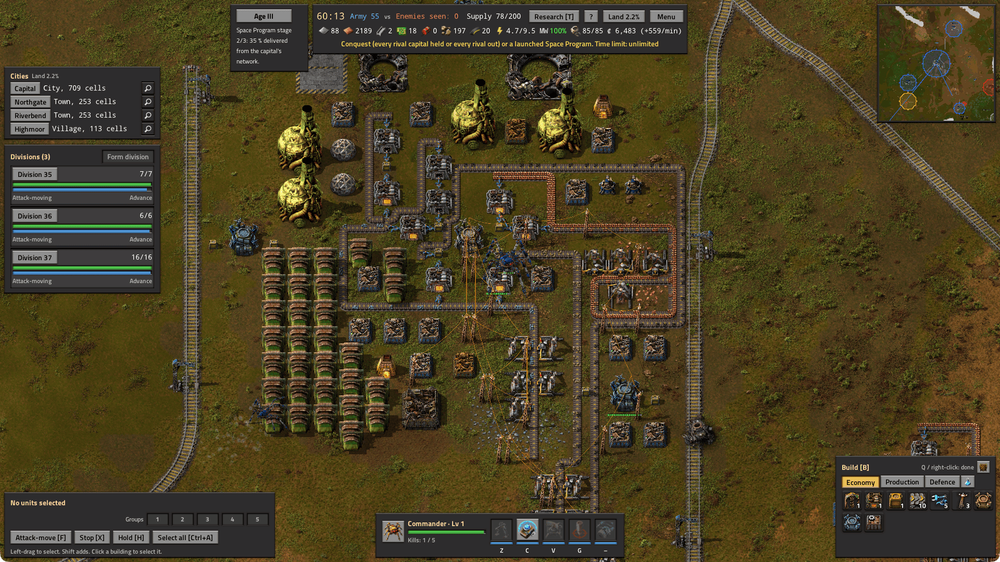

**Version 0.1.1** for Factorio 2.1 · Space Age optional · [Mod Portal](https://mods.factorio.com/mod/factorio-rts) · [Full feature list](docs/FEATURES.md) · [Changelog](CHANGELOG.md) · [MIT license](LICENSE)

Contents: [Gallery](#gallery) · [Highlights](#highlights) · [Requirements](#requirements) · [Install](#install) · [Quick start](#quick-start) · [Controls](#controls) · [The economy](#the-economy) · [Your first Skirmish match](#your-first-skirmish-match) · [Units](#units) · [AI and difficulty](#ai-and-difficulty) · [Nation mode](#nation-mode) · [Multiplayer](#multiplayer) · [Known limitations](#known-limitations-and-open-issues) · [Roadmap](#roadmap) · [Development](#development) · [Contributing](#contributing) · [License and credits](#license-and-credits)

## Gallery

| | | |
|---|---|---|
| 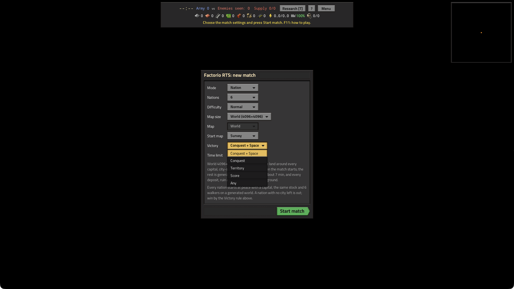<br>The lobby: a Nation match with 6 nations on a 4096 world, choosing the victory mode | <br>A capital at City tier in Age III: districts, hubs, rail depots, stockpiles and haulers on the move | 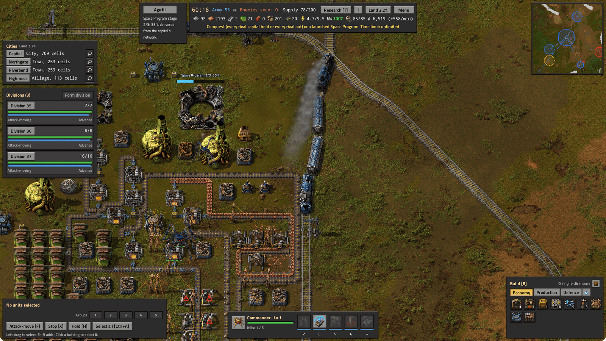<br>A freight train leaves the capital's depot on an open line to a town |
| 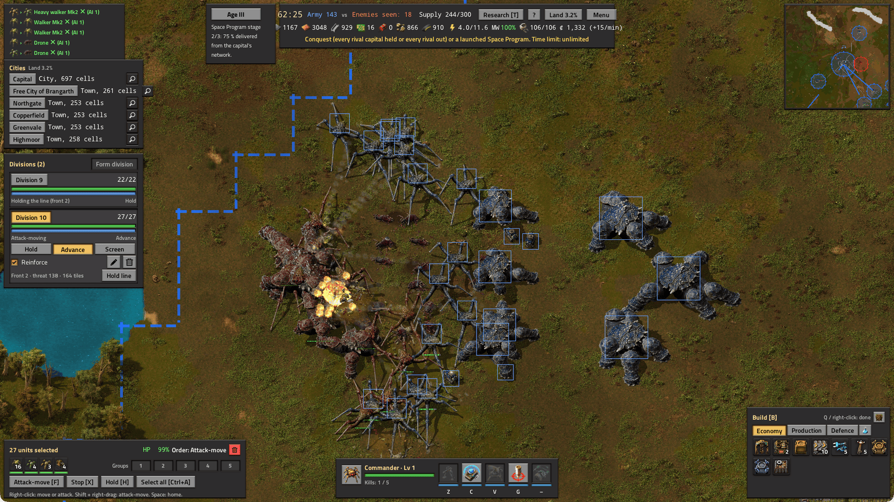<br>A division of Mk2 walkers, heavies, armoured cars and artillery attack-moves into an AI army | 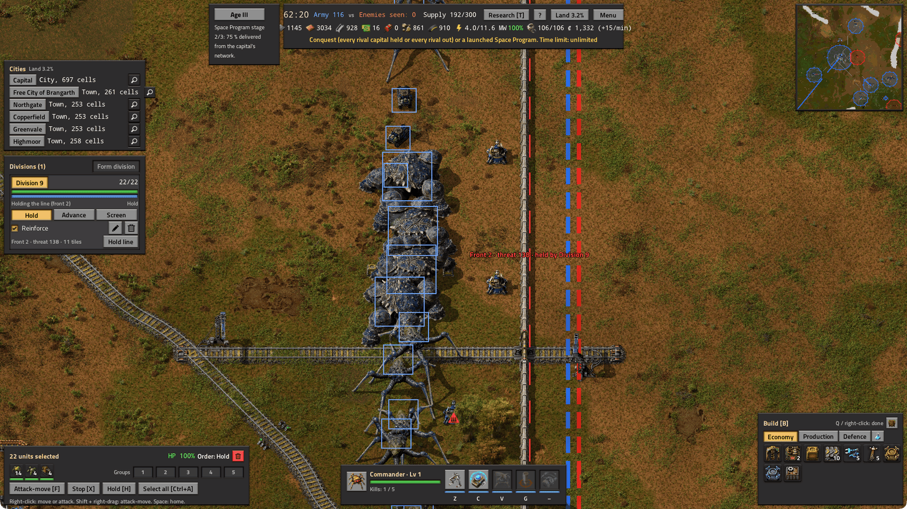<br>A division holds a front behind a fort belt: a wall with turrets along the border | 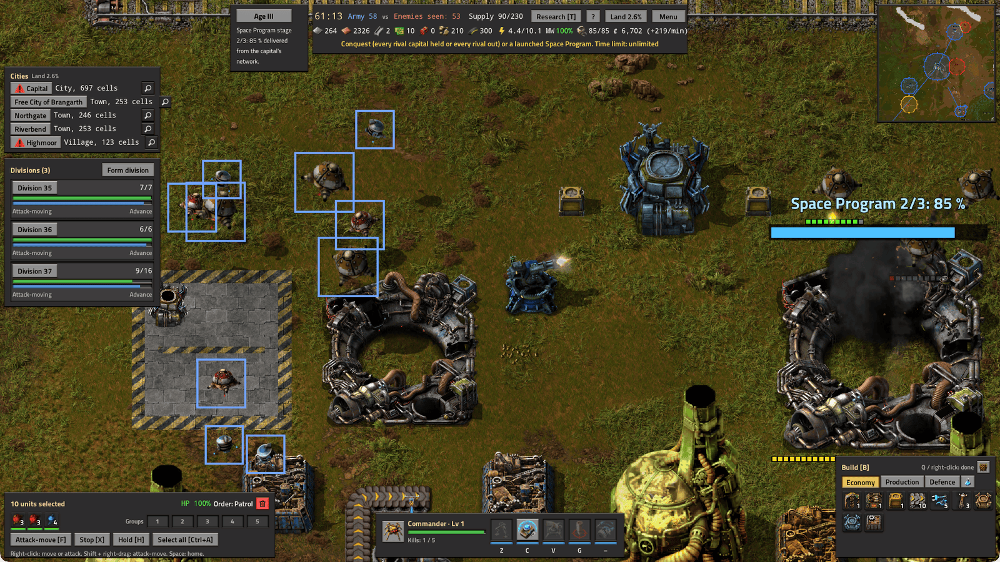<br>Planes over the capital's airfield while its AA turret fires at incoming bombers |
| 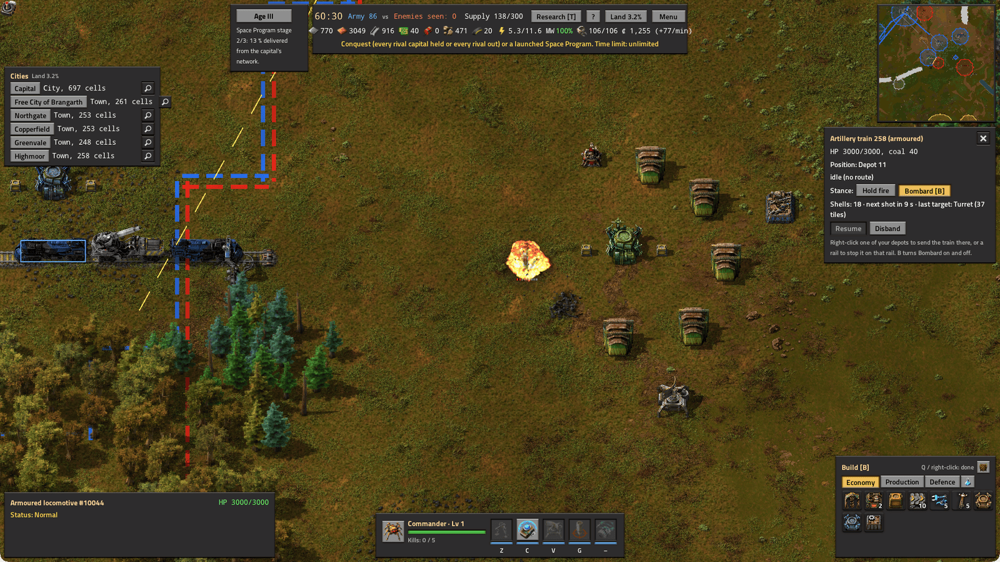<br>An armoured artillery train in Bombard shells an enemy village 45 tiles away | 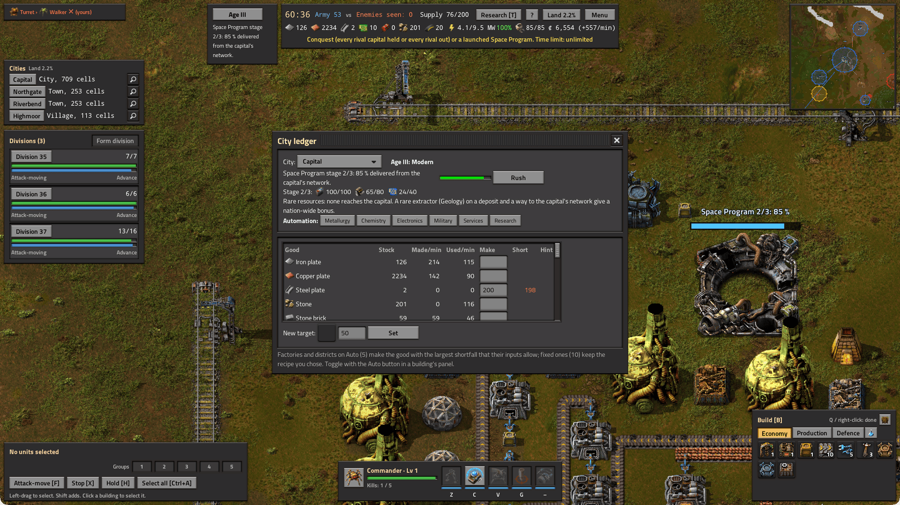<br>The city ledger in Age III: Space Program stage 2 deliveries, Rush and automation, next to the Launch complex | 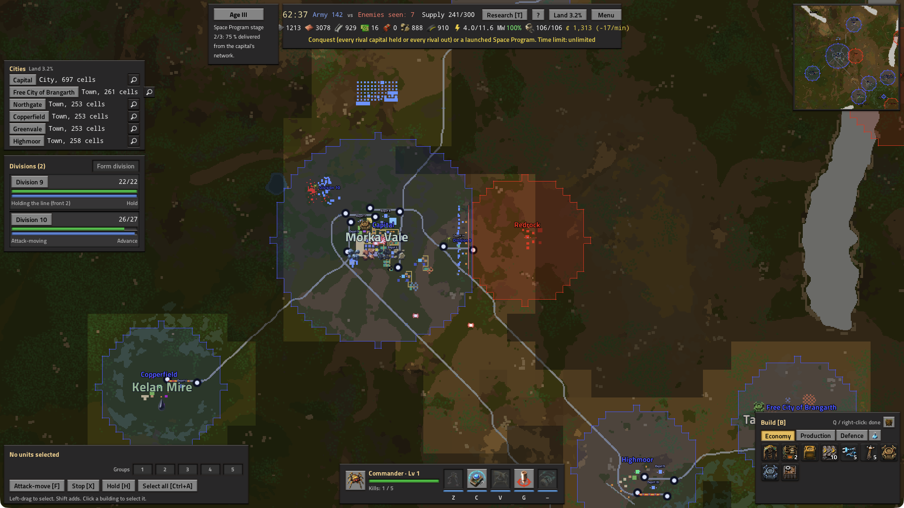<br>The strategic map: your cities and land, a rival town across the front, a city-state, rails and divisions |
| 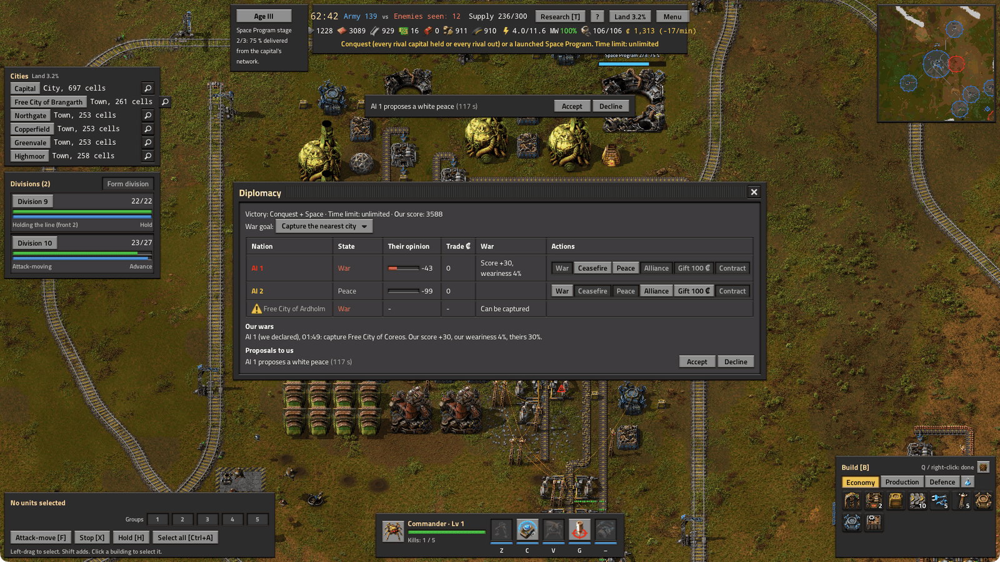<br>The diplomacy panel (F4): a war, a peace, a city-state and an AI's white-peace proposal | 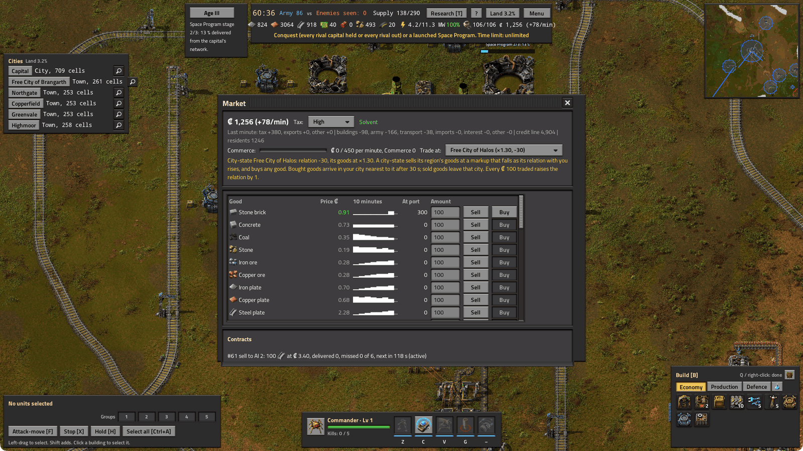<br>The market panel (M): treasury, tax, prices, city-state trade and a contract | 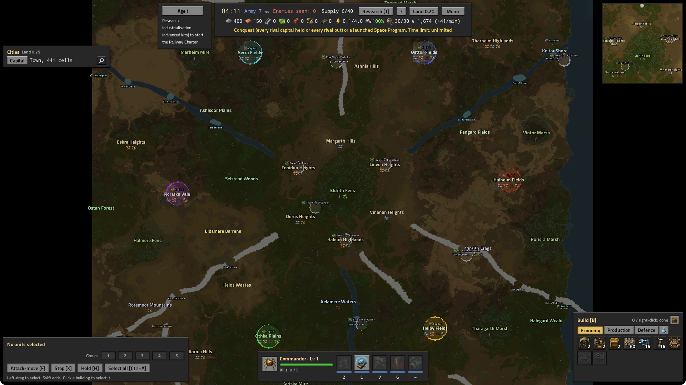<br>A fully generated 4096×4096 world with six nations, regions, rivers and mountain ranges |
| 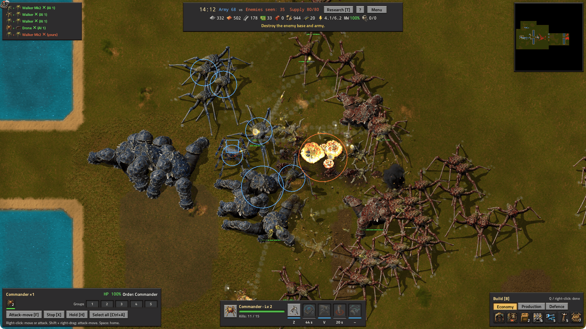<br>Skirmish: the Commander's Shield and an Artillery strike, with the ability bar | 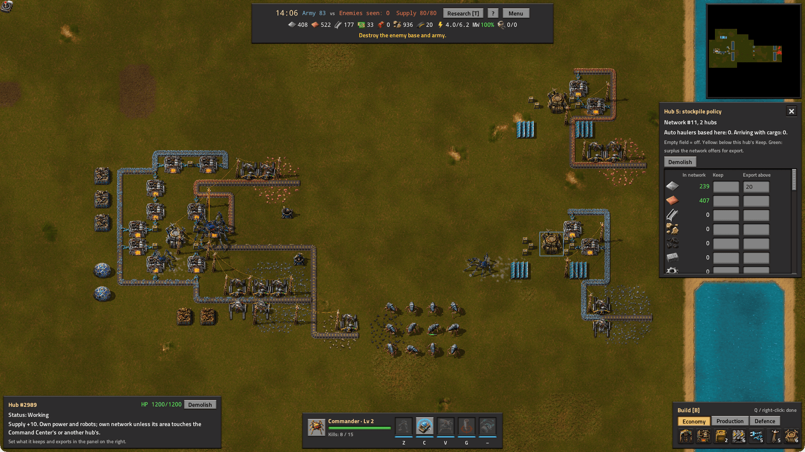<br>Skirmish: a factory base, an army at the rally point and a hub's export policy at the natural | 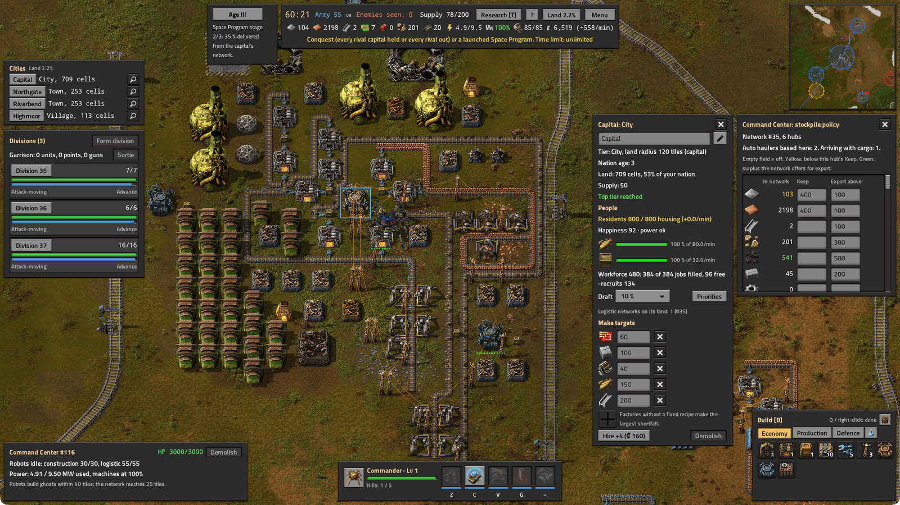<br>The capital's city panel: residents, happiness, needs, workforce, draft, make targets and Hire |

## Highlights

- **RTS controls on top of Factorio.** A free camera, box select, right-click orders, attack-move, control groups, a minimap, unit cards, alerts and a kill feed. There is no character to walk around.
- **An economy you build.** Extractors mine finite patches, ore goes through smelters, belts and inserters into stockpiles, factories make buildings and science, and the barracks turns plates into units. Forward hubs run their own logistic networks, and haulers carry goods between them and can be raided.
- **Counters, research and a hero.** Five combat unit types in a counter wheel with Mk2 upgrades, 19 Skirmish technologies, five abilities and a Commander hero who builds in the field and levels up.
- **AI commanders that play by the rules.** Each AI draws an economic, aggressive or turtle doctrine, builds a real base, expands, raids your haulers, researches and attacks.
- **Nation mode: a small state.** Worlds of 2048, 3072 or 4096 tiles with 2 to 6 nations, named regions, mountain ranges, rivers with fords, neutral city-states, trade ports and ruins.
- **Cities, people and money.** Up to 4 cities per nation claim territory, house and feed residents who staff your buildings and become your recruits, and pay into a treasury that funds upkeep, soldiers and imports on a shared world market.
- **Railways with a purpose.** Select a depot, right-click another, and the game surveys a route and sends a construction train to lay it. Freight, troop, artillery and armoured trains run on it.
- **Three ages.** The Railway Charter brings Age II (oil as goods, districts, armoured cars, bunkers). The Space Program brings Age III (chemistry, nuclear power, automation) and, on its third stage, a Space victory.
- **War is logistics.** Divisions burn supply, enemy land bleeds your armies, cities are captured rather than razed, and wars end in treaties. Garrisons, fronts, fort belts, air units with anti-aircraft (AA) defence and artillery trains round it out.
- **A layered nation AI without cheats.** An economic planner, city governors, a war council, division controllers and an intelligence layer that only knows what its units see. Difficulty changes skill, never resources.
- **Tested hard.** Headless autotests, save/load and determinism checks, a 60 UPS (updates per second) performance budget, multiplayer desync checks and GUI passes by an automated tester. English and Russian.

## Requirements

- **Factorio 2.1** (tested on 2.1.23). This version does not load on Factorio 2.0.
- **Space Age is optional.** With it, units use the Gleba pentapod graphics, rail lines can cross water on bridges and food spoils. Without it, units are built from the spidertron, and rations keep. Drones use biter graphics either way.
- **Platforms.** The mod is developed and tested on macOS (Apple silicon, Steam build). It is pure Lua and uses only the game's own graphics, so it should run wherever Factorio 2.1 runs, but:
  - **Windows is untested.** Nobody has played it on Windows yet. If you do, please tell us how it went, whether it works or not: open an issue with the [bug report template](https://github.com/Kealman/factorio-rts/issues/new?template=bug_report.md), which asks for the OS, the Factorio and mod versions and `factorio-current.log`.
  - **Linux: the headless autotests pass, the GUI client is untested.** On the official Factorio 2.1.23 headless build for Linux, in Docker, the Skirmish smoke test (65/65) and a Nation match (53/53) pass with 0 errors on x86-64 and ARM64, with and without Space Age, and log the same lines as on macOS. No `require` or file path in the mod differs in case from the files on disk. `tools/linux/run.sh` repeats the check in one command. Reports from Linux players are welcome the same way.
  - The development tooling under `tools/` is macOS-shaped.
- **Play it alone, in a new game.** The mod is designed to run with the base game and, optionally, Space Age. Other mods are untested; mods that change the character, freeplay or map generation are likely to conflict. It takes over the session (no character, its own surfaces), so do not add it to a save you care about.

## Install

**From the Mod Portal.** In the game's main menu open **Mods**, search the online mods for "Factorio RTS", install it and let the game restart. You can also download it from [mods.factorio.com/mod/factorio-rts](https://mods.factorio.com/mod/factorio-rts).

**Manually.** Download `factorio-rts_0.1.1.zip` from the [GitHub releases](https://github.com/Kealman/factorio-rts/releases) and put the zip, unpacked or not, into your mods folder. Then enable the mod in **Mods**.

| System | Mods folder |
|---|---|
| Windows | `%APPDATA%\Factorio\mods` |
| macOS | `~/Library/Application Support/factorio/mods` |
| Linux | `~/.factorio/mods` |

**From source (macOS, Steam build).**

```sh
tools/install.sh      # copies mods/factorio-rts into ~/Library/Application Support/factorio/mods
                      # and enables only base, the Space Age DLC mods and factorio-rts (your old mod list is backed up)
tools/uninstall.sh    # removes the mod and restores the backed-up mod list
tools/package.sh      # builds build/release/factorio-rts_<version>.zip, the archive the Mod Portal takes
```

## Quick start

Start Factorio and choose **New game** with the **Freeplay** scenario. The RTS lobby opens as soon as you join. Pick your settings and press **Start match**:

- **Mode:** *Skirmish* (the arena maps below) or *Nation* (a generated world, see [Nation mode](#nation-mode)).
- **Opponents:** 1 to 3 AI commanders, free-for-all. In Nation mode this is **Nations**: 2 to 6 including you.
- **Difficulty:** easy, normal or hard.
- **Map size** (Skirmish): small (256×256), medium (384×384) or large (512×512).
- **Map** (Skirmish): *Chokepoints* puts a 16-tile water moat in front of every base, with one 14-tile land gap, plus lakes and forests. A small map with 2 or 3 opponents has no room for moats and gets only lakes and forests. *Open field* is flat grass. Both maps have the same ore patches and a ruin in the middle.
- **World size, Start map, Victory and Time limit** (Nation): see [Starting a Nation match](#starting-a-nation-match).

Every side starts with a Command Center (CC), the same stock and 6 walkers. Human players also get a Commander. **F11** opens How to play at any time (Nation mode adds its own help page), and **F10** opens the match menu. **Guided objectives** (a switch in the lobby, on by default for your first match of each mode) show a short checklist of first steps at the top right and tick off as you play.

## Controls

| Input | Action |
|---|---|
| WASD / mouse wheel | Pan / zoom (remote view) |
| Space | Camera to your CC |
| Click on the minimap | Camera jumps there |
| Left click | Select one unit (the whole division if it belongs to one); if no unit is there, select your own building, or a train by any of its carriages |
| Left drag | Box-select units |
| Shift + left click / drag | Add to the selection (only the units hit, even inside a division) |
| Ctrl+A | Select your army: every combat unit and the Commander, not the haulers |
| Ctrl+1..5 / 1..5 | Assign / recall a control group (double tap: camera jumps to it) |
| Click / Shift + click a unit card | Keep only that unit type / drop it from the selection |
| Right click | Move, or attack the enemy under the cursor |
| F, then right click | Attack-move (press F or X again to cancel) |
| Shift + right click | Attack-move |
| X / H | Stop / hold position |
| Right click with a barracks selected | Set its rally point |
| Right click a hub or CC with haulers selected | Set the route's pickup |
| Shift + right click a hub or CC with haulers selected | Set the route's drop-off |
| Right click the ground with haulers selected | Move there and park (**Resume** in the hauler panel restarts the route) |
| Z / C / V / G | Stim / Shield / Scanner sweep / Artillery strike (see below) |
| B | Show or hide the build menu |
| Left click on the map while placing | Place a ghost (R rotates) |
| R / Shift + R | Rotate the building or ghost under the cursor (while placing: the ghost on the cursor) |
| Q or right click | Stop placing |
| T | Research panel |
| Delete or Backspace, or the **Demolish** button | Demolish the selected own building (two presses, see [Demolishing](#demolishing)). Nation: with units and no building selected, disband them (two presses) |
| F3 | Jump to the newest alert (press again for older ones) |
| F10 | Match menu: resume, restart, concede (click twice); after the match, the results again |
| Esc | Game menu: save, load, settings, exit (the RTS panels close first if one is open) |
| F11 | How to play |
| F1 | Get the RTS cursor back |
| **Nation mode only** | |
| L, or a click on the age badge | City ledger (age, national project, goods, make targets) |
| M, or a click on the treasury in the strip | Market panel (prices, sell and buy at your port, tax level, contracts) |
| F4 | Diplomacy panel (war, ceasefire, peace, alliance, gifts, contracts, proposals) |
| N | The HUD minimap shows the region around the camera or the whole world |
| Y | The air panel (airfields, planes, **Patrol**, **Return to airfield**) |
| Right click another own depot with a depot selected | Lay a rail line between the two depots |
| Right click a depot or rail station with a train selected | Add it as the train's last stop (Shift: insert it after the stop selected in the train panel) |
| The Rail button (build menu, Economy tab) | The Rail tool: left-click waypoints to lay track; right click or Backspace takes the last segment back; Q or **Done** ends it |
| F with no unit selected, or the gate button in the build menu's header | The fort belt tool (right-click 2–6 points in your land, then **Build**) |
| B with your train selected | Bombard (an artillery train fires at hostile buildings in range) |
| H with whole divisions selected and the cursor at a front | They spread along that front and hold it (elsewhere H holds position) |
| Right click your City Center or CC with units selected | They enter its garrison |
| Right click your depot with units selected | They board a troop train there |
| **Testing (admin)** | |
| Ctrl+Shift+R | Restart the current match with the same settings |
| Ctrl+Shift+E | Write a state summary and the `RTS_QA_END` marker to the log |
| The grave key (`` ` ``), or F9 in `tools/gui-run.sh` clients | Game console: chat and the admin commands under [Development](#development). A chat line `RTS_QA_END` also writes the end marker |

On macOS, every Ctrl chord also works with Cmd. You can rebind keys under Settings → Controls; the mod's controls are named "RTS: …", "Ability: …", "Research panel" and "City ledger". Haulers are left out of Ctrl+A; select them with a click or a box.

**Abilities** are on the bar at the bottom centre. Cooldowns are per side.

| Key | Ability | Needs | Effect | Cooldown |
|---|---|---|---|---|
| Z | Stim | Damaged units selected; 10 iron per unit | Heals 30 % of max hit points (HP); drones and the Commander also move 50 % faster for 8 s | 30 s |
| C | Shield | A live Commander | The Commander and your units within 8 tiles take half damage for 10 s | 45 s |
| V | Scanner sweep | *Scanner sweep* research; then right-click a target | Reveals a 48×48 area for 30 s | 60 s |
| G | Artillery strike | An artillery walker 8–44 tiles from the target (its own range); then right-click a target | Each one fires 2 shells, then keeps attacking there | 20 s |
| (button only) | Overcharge | *Overcharge* research and a CC | Turrets deal double damage for 10 s while the CC's buffer loses 1 MW | 90 s |

After you press V or G, the ability waits for your target. Pressing the key again, X or F cancels it.

### Demolishing

Select an own building and press Delete or Backspace, or the **Demolish** button: the first press arms (the button turns red), and a second press within 3 s demolishes it. 50 % of its cost goes back to the nearest other stockpile of its logistic network, else to another own stockpile within 64 tiles, else to your Command Center's network; a refund with no room anywhere spills on the ground with an alert. The building's contents go to another stockpile of its network or spill on the ground. A hub, depot or City Center takes its stockpiles with it. The Command Center, the capital and trains cannot be demolished ("Locomotive cannot be demolished."). In Nation mode, Delete with units and no building selected disbands them the same way (two presses; their recruits go home).

## The economy

Both modes share this economy; Nation mode adds the layers in [Nation mode](#nation-mode).

**The pool.** Your CC is a roboport with 3,000 HP, 20 construction and 10 logistic robots, 4 stockpiles and a 4 MW power core. Its logistic network covers 25 tiles in every direction, and its robots build up to 40 tiles out; further out, the Commander builds (see below). Stockpiles inside a logistic area belong to that network, and barracks, factories, labs and turrets pull what they need from the network they stand in. A building outside every logistic area gets nothing. Everything you order is a ghost. Construction robots build a ghost from items in the network, but only inside a construction area; the CC's panel shows both ranges.

**Chains.** Extractors mine 1 ore/s from the 5×5 tiles under them. Each one drops its ore onto a belt or straight into a smelter. A smelter makes 0.625 plates/s, so one extractor keeps about 1.6 smelters busy. Smelters also turn stone into bricks and iron plates into steel (2 plates per steel, 3.2 s). A fast inserter moves the output into a stockpile. Stone and coal need no smelting: run them on a belt, then an inserter, into a stockpile. The **factory** repeats the recipe you pick in its panel and sends the output to the network. It makes buildings, belts, inserters, poles, magazines, intermediates (gears, cable, circuits, explosives from coal and iron), science kits and hauler kits. The **barracks** turns plates into unit kits, and each finished kit walks out to the rally point.

| Building | Cost | Building | Cost |
|---|---|---|---|
| Extractor | 20 iron, 5 copper | Lab | 24 iron, 8 copper |
| Smelter | 20 iron, 10 stone | Hub | 32 iron, 10 copper |
| Stockpile (48 slots) | 20 iron, 5 copper | Solar array (400 kW) | 10 iron, 15 copper |
| Factory, Barracks | 60 iron, 20 copper each | Accumulator | 10 iron, 10 copper |
| Turret | 40 iron, 10 copper | Steam plant (research) | 40 iron, 10 steel |
| Laser turret (research) | 20 iron, 10 circuits | Radar | 20 iron, 10 circuits |
| 5 walls | 5 stone bricks | 10 belts / 10 magazines | 10 iron |

**Hubs** are forward bases. A hub has 1,200 HP, a logistic radius of 14 and a construction radius of 22. It comes with 10 construction and 6 logistic robots, plus 5 more logistic robots after *Logistics I*. Two stockpiles appear beside it, and an internal 300 kW generator powers the hub and about two extractors through its own 16×16 pole. Every hub adds +10 supply. Hubs whose logistic areas touch share one network. The CC's area and a hub's touch when the hub is within 39 tiles of the CC; two hubs touch within 28 tiles. Each hub or CC has a **stockpile policy** in its panel. *Keep N* means haulers bring the item until the network holds N. *Export above N* means anything over N is offered to haulers. By default, a CC exports iron, copper and steel above 100, and a new hub keeps 50 iron and 20 copper but exports nothing. To ship a hub's output home, set its *Export above*. In the panel a count is yellow below this hub's *Keep* and green for the surplus the network offers for export.

**Building at the natural expansion: the Commander.** Your natural iron and copper pair lies 50 tiles out on a small map, 70 on medium and 76 on large, beyond the CC's 40-tile robot reach. The **Commander** builds there: its personal roboport builds every ghost within 15 tiles of it, and while it stands there its trunk is stocked from your CC's pool with the items those ghosts need (anything left over goes back when you walk away). So: let the factory make a hub (and later the extractors, smelters, inserters and poles for the outpost); select the Commander, right-click next to the natural ore to walk it there, and place the hub ghost near it. Its robots build the hub within seconds, and the pool pays exactly what a CC robot would take. The same works for the middle patches and the ruin.

A hub at the natural is more than 39 tiles from the CC, so it has its own network. Its stockpiles start empty, and mined plates stay there until a **hauler** takes them home: set the hub's *Export above* (for example iron above 20), make a hauler, and give it a route: right-click the natural hub (pickup), then Shift + right-click the CC (drop-off). A hub within 39 tiles of the CC (logistic areas touch) or 28 tiles of another joined hub joins that network instead and needs no haulers.

**Haulers** carry items between separate networks: a hub at a natural or middle patch, the ruin's stockpiles, or a chain of hubs cut because its middle hub died. The factory makes a hauler from a hauler kit (30 iron, 10 circuits). It walks out in **auto** mode, homed at the hub of the factory's network. An auto hauler fills its home's *Keep* amounts from the nearest network that exports the item. For a **manual route**, right-click the pickup hub and Shift + right-click the drop-off hub. The hauler loads what the pickup exports and the drop-off wants (a drop-off with no *Keep* set takes every export), and loops until you change it. Haulers have 400 HP, 20 cargo slots (+10 with *Hauler capacity I*), no weapons and about twice a walker's speed, and they path around water. Raiders deal 2.5× damage to them and drones hunt them; each loss raises an alert. In Nation mode haulers carry less and burn coal: see [Haulers in Nation mode](#haulers-in-nation-mode).

**Supply.** The cap is 40 with a CC, +10 per hub, and +10 each for *Supply I* and *Supply II* (in Nation mode also +10 per depot, the supply of your other cities and +15 for *Supply III*). Walkers and drones cost 1 supply, raiders 2, heavies 3 and artillery 4; Mk2 units cost the same as their base unit. Haulers and the Commander are free. At the cap, a finished kit waits in the barracks until a unit dies or the cap grows.

**Research.** Labs take science kits from their network, at 10 s per kit per lab, so more labs research faster. The factory makes **basic kits** from 1 gear + 1 copper plate (5 s). Gears come from the factory too, at 2 iron each. **Advanced kits** take 2 circuits + 1 steel (10 s); a circuit is 1 iron + 3 copper cable, and one copper plate makes 2 cable. Tier 1 uses basic kits and tier 2 advanced kits. Nation mode adds more technologies (Railways, the age projects, air, fortification and more); they are described where they matter in [Nation mode](#nation-mode).

| Technology | Kits | Effect |
|---|---|---|
| Supply I / II | 8 basic / 20 advanced | +10 supply each |
| Attack I / II / III | 15 basic / 25 / 40 advanced | +15 % damage for units and turrets, per level |
| Armor I | 15 basic | Barracks deploy Walker Mk2 and Heavy Mk2 (+40 % HP, +25 % damage) from the same kits |
| Armor II / III | 25 / 40 advanced | Units heal back 10 % of each hit, 20 % with both |
| Mining I / II | 11 basic / 25 advanced | +25 % ore per level; the patch drains no faster |
| Logistics I | 11 basic | Robots 50 % faster with +1 cargo; +5 robots per hub |
| Hauler capacity I | 11 basic | +10 hauler cargo slots |
| Heavy walkers / Raiders | 11 / 15 basic | Unlock the unit |
| Artillery walkers | 30 advanced (needs Heavy walkers) | Unlocks artillery |
| Laser turrets / Steam power | 25 / 20 advanced | Unlock the building |
| Overcharge (needs Laser turrets) / Scanner sweep | 25 / 20 advanced | Unlock the ability |

**Power.** The CC core supplies 4 MW and powers everything within 18 tiles; medium poles carry it further. Other sources are a hub's 300 kW, solar arrays (400 kW each, steady, because the arena is always day) and steam plants. A steam plant needs the *Steam power* research, gives 1.8 MW and burns 0.45 coal/s that an inserter feeds in. Accumulators store spare power for peaks. For scale, an extractor draws 90 kW, a smelter 180 kW and a lab 60 kW. A laser turret needs no ammo but takes 800 kJ per shot, up to 2 MW while it fires. Low power slows every machine.

**Depletion and expansion.** Patches are finite. In Skirmish:

| Patch | Iron | Copper | Stone | Coal |
|---|---|---|---|---|
| Main | 6,000 | 4,000 | 3,000 | 3,000 |
| Natural | 8,000 | 4,000 | – | – |
| Middle | 12,000 | 8,000 | – | 6,000 |

A main iron patch at full speed lasts 50 minutes with 2 extractors, 25 with 4, about 17 with 6 and 12.5 with 8. An extractor that feeds a single smelter only drains 0.625 ore/s, so 4 such lines last 40 minutes. The normal AI's main iron lasts about half an hour. Extractors on the thin edge of a patch run dry first. A *patch depleted* alert tells you when a patch is empty.

**The ruin** sits in the middle of the Skirmish map: a dead CC with two stockpiles holding 200 steel plates and 50 circuits. A unit standing within 4 tiles of a ruin stockpile for 10 s captures both stockpiles, as long as no other side's units are there. A rival can take them back the same way. The stockpiles only join a network if a hub stands next to them: walk the Commander there to build one, then haul the steel and circuits home.

## Your first Skirmish match

You start with 400 iron, 150 copper, 2 extractors, 2 smelters, 1 barracks, 1 factory, 2 stockpiles, 60 belts, 16 fast inserters, 16 medium poles, 6 walkers and the Commander. All of the buildings are still items in the stockpiles. Your iron patch is about 17 tiles in front of the CC and 10 to one side, with copper on the other side and stone and coal further out. This plan mirrors the normal AI's opening.

**Play your first game on Easy.** Easy's first attack comes at 5:00 at the earliest and at least 4 minutes pass between attacks. On Normal an aggressive AI attacks at 3:00, so keep the barracks making walkers from the first minute and keep your army near the CC.

1. **0:00** Place the factory next to the CC. Build two iron lines (each an extractor feeding a smelter, then an inserter into one of your spare stockpiles) and connect them with poles. Place the barracks.
2. **0:30** Set the factory to make extractors. Put one on stone and belt it into a stockpile, because every new smelter costs 10 stone. Add a third iron extractor.
3. **1:00–1:45** Build a lab and a second factory. Set that factory to basic science kits, and have the first factory make about 10 gears between buildings. Press T and research Supply I (8 kits) or Mining I first.
4. **1:45–3:00** Add iron smelters 3 and 4 and a copper extractor with its smelter. Start the barracks on walker kits once 3 or 4 iron smelters run: a busy barracks eats about 200 iron per minute, and one smelter makes 37. Put two turrets towards the enemy and make magazines.
5. **3:00** On Normal, an aggressive AI attacks now (economic at about 5:00, turtle at 6:30; see below). Your walkers, the Commander's rockets, Shield (C) and Stim (Z) hold it.
6. **3:30** Set up a steel smelter that gets iron plates from another smelter by inserter; heavies need steel. Add a second lab and a feeder factory for gears or circuits.
7. **~4:00** First hub at the natural: the factory makes it, you walk the Commander to the natural ore and place the hub ghost next to it, and the Commander's robots build it (see above). Then extractors and smelters on the natural feeding the hub's stockpiles, *Export above* on the hub and a hauler to bring the plates home.
8. **By 6:00** Aim to have Supply I and one unlock (Heavy walkers or Raiders) done, and to mix units by counter. Walkers and drones need no research, and walkers are your default unit.
9. **6:00–10:00** Make advanced kits (cable, circuits and steel) for Artillery walkers, Laser turrets and Supply II, expand to the middle patches and contest the ruin.

**Winning.** A side is out when it has no CC, barracks or factory and no combat units left (haulers and the Commander do not count). You win when every AI is out and you are not. The results window lists every side's units and buildings built and lost; **Concede** in the F10 menu ends the match as a defeat, and the menu's **Results** button shows the window again after you closed it. Nation mode has its own victory rules (see [Diplomacy, wars and victory](#diplomacy-wars-and-victory)).

## Units

| Unit | Kit cost | Supply | HP | Range | Role | Beats | Loses to | Unlock |
|---|---|---|---|---|---|---|---|---|
| Walker | 10 iron, 2 copper | 1 | 200 | 20 | Ranged line | drones, raiders | heavies, artillery | – |
| Drone | 6 iron | 1 | 85 | melee | Fast swarm; bites ignore heavy armour, ×3 vs raiders | artillery, raiders | turrets, walkers | – |
| Heavy walker | 30 iron, 10 copper, 5 steel | 3 | 800 | 16 | Tank: 60 % physical armour, splash | walkers, drones | artillery, laser turrets | Heavy walkers |
| Raider | 8 iron, 2 circuits | 2 | 220 | 18 | Fast raider: ×2.5 vs economy buildings, poles, hubs, haulers | artillery | walkers, turrets, drones | Raiders |
| Artillery walker | 40 iron, 5 steel, 10 explosives | 4 | 450 | 44 (min 8) | Siege, area shells, ×9 vs heavies | heavies | drones, raiders | Artillery walkers |
| Walker / Heavy Mk2 | same kit as the base unit | 1 / 3 | 280 / 1,120 | 20 / 16 | +25 % damage | as base | as base | Armor I |
| Commander | free, one per player | 0 | 2,000 | 30 | Hero: rockets; level 2 at 5 kills and level 3 at 15, each adding a 400 shield; respawns at the CC 60 s after dying | – | – | – |
| Hauler | 30 iron, 10 circuits (factory) | 0 | 400 | – | Unarmed cargo | – | raiders, drones | – |

Kits come from the barracks: walkers take 3 s, drones 2 s, raiders 5 s, heavies 8 s and artillery 12 s. Speeds relative to a walker: drone ×1.45, raider ×1.35, artillery ×0.65, heavy ×0.55. Nation mode adds the Armoured car (Age II) and three planes (Age II and III); see [Ages](#ages) and [Air](#air).

Defences:

- **Turret:** 1,200 HP, range 21, about 42 damage/s, fed with magazines from the network.
- **Laser turret:** 1,000 HP, range 22, 75 damage/s from power.
- **Wall:** 500 HP per segment.
- **Radar:** keeps a 160×160-tile area visible.

You see only what your units and buildings see.

## AI and difficulty

**Skirmish.** Each AI side draws a **doctrine** at match start. The draw is seeded by the map seed, the match number and the AI's number, so AIs in one match can differ and a new match draws again. An admin can override it with `/rts-ai-doctrine <force> <name>`.

- **Economic:** builds units after its third iron smelter. Its first hub goes up right after the steel chain (around 4:00 on normal), a copper hub follows at about 4:30, and each hub gets a hauler. Two units patrol the route to the hub. Research: Supply I, Heavy walkers, Mining I, Logistics I…
- **Aggressive:** makes units from the start, adds a second barracks at 4:00, and fields drones and raiders (Raiders right after Supply I). It harasses haulers and outlying buildings every 2 minutes, targets extractors and hubs first and builds its hub late.
- **Turtle:** builds turrets from 1:15 (up to 6), then coal and explosives for artillery, solar arrays, two laser turrets once researched, and a late hub.

| | Easy | Normal | Hard |
|---|---|---|---|
| Build pace (one construction job per) | 6 s | 3 s | 2 s |
| First attack: aggressive / economic / turtle | 5:00 / 8:30 / 11:00 | 3:00 / 5:06 / 6:36 | 1:30 / 2:33 / 3:18 |
| Attack size (units): aggressive / economic / turtle | 5 / 6 / 7 | 8 / 10 / 11 | 10 / 12 / 13 |
| Time between attacks | at least 4 min | none | none |
| Vision | what its units and buildings see | what its units and buildings see | the whole map |
| Bonuses | – | – | +50 % starting stock, +25 % mining, every 4th unit free |

Easy opens with one iron and one copper smelter, and only half of its idle army defends. Hard runs the normal build order with time gates ×0.7, and its economic and turtle doctrines add a second barracks. The AI researches its unlocks like a player and its barracks obey the same locks.

**Nation.** The nation AI plays by the player's rules with a layered design: a **strategist** (taxes, trade, contracts, war and peace), an **economic planner** (city sites, rail trunks, the road to Age III), a **governor** per city (food, goods, housing, labor), a **war council** (fronts, fort belts, operations, air patrols, sieges) and **division controllers**, all fed by an **intelligence** layer that only knows what its units see. In Nation mode difficulty changes skill, never resources: easy, normal and hard differ in how fresh their intelligence is, how many operations run at once, how fast they build and how well they handle their divisions. Details are in [What the AI does in Nation mode](#what-the-ai-does-in-nation-mode).

## Nation mode

Nation mode turns a match into a small state. You found cities on a large generated world, claim the land around them, feed and house their people, connect them by rail, ship goods between them, keep a treasury, trade on a world market, make war and peace with the other nations, and capture their cities. Everything from Skirmish still works; Nation adds the layers below, and Skirmish matches are unchanged by them. A Nation match is meant to run one to three hours and to be saved and resumed. F11 shows a Nation help page (it scrolls) with every rule and hotkey below in short.

### Your first Nation match

1. **Lobby.** Set **Mode** to *Nation*, **Nations** to 2, **Difficulty** to easy and keep the 2048 world and *Conquest + Space*.
2. **Opening.** Build the Skirmish opening at your capital (iron, copper and stone lines, a factory, a lab), and add a coal line early: in Nation mode haulers and trains burn coal.
3. **Feed the capital.** Its 200 residents eat 20 rations a minute, so the 300 rations they start with last about 15 minutes, and the 100 household goods about 12. Build farms and a bakery (or a fishing hut by water), set a factory to household goods, and add houses as the city grows. The city panel (click your CC) shows every need.
4. **Research Railways** (10 basic kits), then *Industrialisation* (20 advanced kits) for Age II.
5. **Found a second city.** The factory makes a City charter. Place it next to a far ore region, at least 96 tiles from every City Center, and walk the Commander next to the ghost so its robots build it.
6. **Link the cities.** Build a rail depot in each, select one and right-click the other. Keep locomotive and construction wagon kits, rails and coal at the first depot. Once the line is open, deploy a train from the depot panel's builder (the Freight preset), select it and right-click the depots it should stop at.
7. **Age II.** Start the Railway Charter in the ledger (L), then build districts and set make targets so your factories run on Auto.
8. **Money and trade.** Watch the treasury on the top strip and take a trade port with one military unit to sell your surplus (M).
9. **War.** Declare war from the diplomacy panel (F4) with a goal, form divisions, keep supply crates in depots near the front, and capture cities by subduing their City Centers.
10. **Age III.** Research *Electrification* and start the Space Program. Its third stage launches a rocket that wins the match under *Conquest + Space*.

### Starting a Nation match

In the lobby set **Mode** to *Nation*. The map type becomes *World* (greyed). **Nations** sets how many nations share the world (2 to 6, you included; at most 4 on 2048), and the size drop-down offers 2048×2048 (the default), 3072×3072 or 4096×4096; 5 or 6 nations move a 2048 world to 3072. **Start map** is *Explore* (only the land around your capital is charted) or *Survey* (the generated world is charted as it appears). **Victory** offers Conquest + Space (the default), Conquest, Territory, Score or Any, and **Time limit** 60, 90, 120 minutes or unlimited; see [Diplomacy, wars and victory](#diplomacy-wars-and-victory). A dim line under the grid says how long the world takes to generate. Every size is playable a few seconds after **Start match**: the land around every capital, city-state and port comes first, and the rest is generated in the background while you play (about 1 minute on 2048, 2½ on 3072 and 4 on 4096; "World: N % generated" under the minimap until it is done).

### The world

Mountain ranges (grey rock that no unit crosses) with passes, rivers with walkable fords, coasts, lakes, swamps, deserts and forests split the world into named regions (highland, plain, lakeland, coast, swamp, desert, forest, mountain) whose names appear on the map and in alerts ("Iron Hills: Hauler lost"). Every nation starts with the same ore within 150 tiles of its capital, laid out as in Skirmish, and gets one *home specialty* region a little closer to it than to anyone else. The large deposits lie between the nations, and on a 4-nation world there are only two large copper regions, so every nation lacks some ore and has to fight or trade for it. Each nation has a home oil field about 300 tiles out, and a large contested oil swamp lies in the middle. Uranium (1–2 deposits on contested ground) is mined only after the *Geology* research, and rare deposits (saltpetre, quartz, tungsten, diamonds, rare earths and gold) on desert and mountain rims and city-state land feed the rare extractors (see [Rare resources](#rare-resources)).

**City-states** (4, 5 or 6 for 2, 3 or 4 nations) are neutral cities on scarce sites (contested copper, the oil swamp, the coast, passes and fords); see [Supply, capture, garrisons and troop trains](#supply-capture-garrisons-and-troop-trains). Ruins (8–12) hold steel and circuits and are captured like the Skirmish ruin. **Trade ports** (2–4, on the coast or the map edge, fair by path for every nation) are your way to the world market. Passes, fords and narrows are named chokes, marked on the map. Worlds of 5 or 6 nations and 4096 worlds have more of everything (7–8 city-states, 5–6 ports, 16 ruins and 10 rare deposits on 4096). At the start only the land within 160 tiles of your capital is charted; the rest stays black until your units or buildings see it.

**The strategic map.** The HUD minimap shows the region around the camera (1,000 tiles); **N** switches it to the whole world and back. Zoom far out and the view turns into the map view: region names with their resources, choke circles, city and city-state names in their owner's colour, port names and markers for your divisions.

### Capital, cities and territory

**The capital.** Your starting CC is your capital: a *town* whose land reaches 96 tiles around it. The HUD adds an **age badge** left of the top strip, a **Land N%** button on the strip (your share of the map) and the **city list** at the top left: one row per city with a button that jumps the camera there and a magnifier that opens its panel. The Land button shows or hides the list.

**Founding a city.** The factory makes a **City charter** (80 iron, 30 copper, 40 stone, 20 s); founding moves 40 settlers from your nearest city that can spare them. Place it from the build menu's Production tab like a hub: at least 96 tiles from every other City Center of any nation, on your own or neutral land, never on enemy land, at most 4 cities per nation (capital included). New sites lie beyond your robots' reach, so walk the Commander next to the ghost; its robots build the City Center from your stock. A **City Center** has 1,800 HP, two stockpiles and its own logistic network (radius 16, 10 construction robots reaching 30 tiles, 6 logistic robots), 1 MW of power, and keeps 50 iron and 20 copper by default like a hub. An alert announces "City founded: <name>".

**Tiers.** A city grows from village to town to city with its residents (see [People and labor](#people-and-labor)): it goes up at the next growth pass after it reaches the next threshold, and falls back only after two minutes below 80 % of its tier's threshold.

| Tier | Land radius | Supply | Residents |
|---|---|---|---|
| Village | 48 tiles | 10 | 20–99 |
| Town | 72 tiles | 20 | 100–399 |
| City | 96 tiles | 30 | 400 and more |

The capital claims 24 tiles more than its tier (96 as a town, 120 as a city) and keeps the CC's supply: 40 as a town, 50 as a city. Its centre heals back half of every hit, so it takes about twice the damage to fall. A city whose City Center dies or is demolished is lost with its land ("City lost: <name>"); a lost capital passes to your next city.

**Territory.** The map is divided into 8×8-tile cells, each owned by one nation or neutral. City Centers claim land by tier, forts 24 tiles, hubs and radars 16; where claims meet, the stronger claim wins, and an owner keeps a cell until a rival beats it by 15 %. Borders are dashed lines in the nation's colour on the ground, and solid lines with a tint on the map and the HUD minimap. They are public: you see the AI's land even where you have not explored. "Territory lost near <city> (N cells)" warns you when you lose land.

| What you build | Your land | Neutral land | Enemy land |
|---|---|---|---|
| Economy: extractor, smelter, factory, barracks, lab, solar array, steam plant, accumulator, Age II buildings and districts, Bunker | yes | no | no |
| Outposts: hub, rail depot, fort, turret, laser turret, radar | yes | yes | no |
| Infrastructure: belts, inserters, poles, walls, rails, stockpiles | yes | yes | no |
| City Center | if 96 tiles from every city | yes | no |

A refused ghost disappears with a flying text such as "Enemy land: nothing can be built here" or "Smelter can only be built on your own land". Buildings on land that changes hands keep working.

**Attrition.** Enemy units at least 16 tiles deep in your land lose 1.5 % of their health every 5 s (about 18 % a minute; the Commander half), unless an own City Center, capital, hub or fort stands within 24 tiles of them. Your armies suffer the same in enemy land.

**Forts** (factory: 30 iron, 20 stone, 6 s) are cheap machine-gun strongpoints: 600 HP, range 18, fed with magazines like a turret (20 come with a new fort). They claim 24 tiles, stand on neutral land and stop attrition for your units nearby, so they carry your land and your supply line forward.

### The city panel, make targets and the ledger

**The city panel** opens left of the stockpile panel when you select your CC or a City Center, or with the magnifier in the city list. It shows the name (a field to rename it), tier and land radius, your nation's age, the city's land cells and their share of your nation, its supply, what the next tier needs, the logistic networks on its land, the city's make targets, the people section (see [People and labor](#people-and-labor)) and a **Demolish** button (greyed for the capital). Demolishing a City Center (two presses, like any building) ends the city: its land goes, and half of the charter's cost returns to another stockpile of its network (a depot's, for example), else to another own stockpile within 64 tiles, else to your Command Center's network.

**Make targets** tell a city how many of a good to keep in stock. Add one with the **+** button under "Make targets" (it opens a picker of the goods your factories and districts can make; the city ledger's item button opens the same picker) and type a number (empty clears it). In Nation mode a new factory or district starts on **Auto**: every second it switches to the good with the largest shortfall among its city's targets that its inputs allow, and stops when every target is met. Choosing a recipe or Pause in the building page fixes it; the **Auto** button (the circular arrows next to Pause) switches it back.

**The city ledger** (L, or a click on the age badge) shows one city at a time: a city drop-down, the age and the national project with its progress, then one row per good with its stock, made and used per minute, the make target (editable), the shortfall and a hint for a short good whose input is missing (one the city neither holds, makes, could make from its stock, nor has a target or a producer for), such as "needs [plastic]: made in <city> (ship it here)" or "needs [crude oil]: made nowhere". Under the table you can add a target for any good. The footer counts the city's factories and districts on Auto and on a fixed recipe.

### Haulers in Nation mode

Haulers carry 10 slots instead of 20 (*Hauler capacity I* and *II* add 10 each) and burn coal: a hauler leaving a hub takes 1 coal per 40 tiles of the trip (×1.1, rounded up) from that hub's network. A hauler leaving for a stop that may have no coal (a route hauler for its drop-off, an auto hauler for the network it fetches from) pays its way back before it leaves: from its tank, then the network it leaves, then the destination's network, so nothing there spends that coal first. One end of a route with coal is therefore enough: keep coal at your capital, and outposts need none. A hauler that stands dry at a hub for 30 s gets its trip paid by the stop it drives to, when that network holds the coal. An auto hauler waits at home for up to a minute for a load worth the trip's coal (25 items per coal of the round trip, "gathering a load worth the trip's coal"), then takes what there is. A walk inside one network (a new hauler from its factory to its home hub) burns nothing. The hauler panel shows the tank after the cargo ("Tank: [coal] 4"). Without coal the hauler waits with "no coal for the trip in the hub network", and an alert "Hauler N: no fuel at <hub>" comes at most every 2 minutes per hauler. While the hauler panel is open, the map view draws the way of each selected hauler to its next stop. Beyond about 300 tiles, trains are the better carrier. In Nation mode every inserter also moves 3 items per swing instead of 1, so one inserter into a stockpile keeps up with several extractors.

### Rails

**Railways** (tier-1 research, 10 basic kits; Nation mode only) unlocks these factory recipes and the Rail tool:

| Item | Cost |
|---|---|
| Rail depot | 40 iron, 10 steel, 10 copper (10 s) |
| Rail station | 20 iron, 4 steel, 4 copper (5 s) |
| Rail signal, chain signal | 5 iron, 1 circuit each (1 s) |
| Rails | 1 steel + 1 stone → 2 rails (2 s) |
| Rail works (district, below) | as a district; with Railways, already in Age I |
| Locomotive kit | 40 iron, 10 steel, 10 circuits (10 s) |
| Cargo wagon kit | 20 iron, 5 steel (6 s) |
| Construction wagon kit | 30 iron, 10 steel (8 s) |

**Depots.** A rail depot (build menu, Economy tab) is a hub with a railway: 1,500 HP, logistic radius 14, construction radius 22, +10 supply, the same keep / export policy as a hub (it keeps 50 coal by default), and a platform with a stop at each end that the game lays next to it (an alert says when there is no room). A platform is 40 tiles long (5 carriages); **Platform of new depots** in the depot panel makes the depots you build afterwards lay 60 (8 carriages) or 80 tiles (11), and one that fits nowhere falls back to 40. Select a depot to see its rail panel left of the stockpile panel: platform, kits, rails and coal in its network, the train builder, its lines and the force's line list. On the map each of your depots is labelled with its panel name ("Depot 2").

**Laying a line.** Select a depot and right-click another of your depots. The game surveys a route in a few seconds (around water, buildings and foreign land; across your own walls, whose pieces under the track become gates), shows it as ghost rails, and sends a **construction train** (2 locomotive kits + 1 construction wagon kit, rails and coal from the first depot's network). It lays about 10 pieces per second, clears trees, rocks and cliffs on the way, and adds signals; the line reads *surveying*, *building*, then *open* ("Rail line open"). A piece the crew cannot lay because something stands on it raises the alert "Rail line blocked: the construction train cannot lay track here"; after two minutes the crew goes home and the line is surveyed again around that spot (a short detour; the rails it took up go back to the depot). A line costs roughly 0.6 rails per tile of new track; curves, signals and bridges cost more. Where your own track leads the right way, the survey runs along it instead (it weighs a fifth of new track): those pieces cost nothing, and chain signals go up where the line leaves or joins it. A depot takes any number of lines.

**The Rail tool** lays your own track (the vanilla rail planner does not run in the RTS view). Open it with the **Rail** button in the build menu's Economy tab. Left-click where the track starts: on one of your rails for a branch, or on free ground. Every further left click plans a segment to that point, with curves and diagonals (a click on your rail joins it); its ghosts appear at once and the bill shows as flying text (pieces, rails, signals, pieces of your track it runs along). Right click or Backspace takes the last segment back (its ghosts go, built pieces stay); Q or **Done** ends the tool. A segment stays on your land or neutral land (the message of any building elsewhere), and one segment reaches at most 600 tiles. Robots build the ghosts their network covers; the rest is laid by a construction train from your nearest depot connected to the segment by track (one crew at a time, kits, rails and coal from that depot's network, as for a line). A segment nothing can reach raises "Track not built: ..." after a minute.

**Signals and junctions.** Your track is single and runs both ways, so the game signals it with chain signals only: a pair every 80 tiles and a pair on each track around a junction. A train enters a stretch only when its way to its next stop is free, so two trains never meet head-on; they wait at a junction instead. A junction turns one way: a branch that leaves the main track heading east cannot be entered by a train heading west. For both directions, lay a second short segment from the main track onto the branch from the other side. Rail signals and chain signals are in the build menu (single clicks, robots build them) for layouts of your own, such as double track.

**Rail stations.** A rail station is a small depot without a platform: 2 stockpiles, logistic radius 10, 800 HP, no supply. Build it within 8 tiles of a straight piece of your track and it puts its two stops on that track, one per direction; until then it shows "Rail station: no track next to it yet". Trains stop there like at a depot (stop lists, loading and unloading, troops); it deploys no trains and takes no lines.

**Trains.** The **train builder** in the depot panel composes a train front to back from the kits in the depot network: click carriages in the palette (locomotives, cargo, troop, artillery and construction wagons, armoured kinds), turn a locomotive round, or pick a preset (Freight, Construction, Troop, Artillery, armoured and mixed trains) or one of up to 5 templates you save. It lists what is missing (kits, 2 coal per locomotive) and refuses what cannot run: the front must be a locomotive facing forwards, and the train must fit the platform. A train with no locomotive facing back can only leave forwards. **Deploy** assembles it on the platform; a greyed Deploy says why in a yellow line (no kits, no coal, the platform occupied, a rail of it missing, enemies on it), and your own units standing on the platform track step off it when the train appears. Click any carriage to select the train and open the train panel; a train standing on its depot's platform can couple a carriage at the rear or take the rear one off there (half its kit back).

**Stop lists.** Right-click a depot or station with a train selected to add it as the train's last stop (Shift: insert it after the stop selected in the panel); troop and artillery trains also take a rail. Click a stop's row for its orders: unload to Keep, everything or chosen items; load exports or chosen items; troops board or get off; Bombard here; and when to leave (cargo idle 10 s by default, full, empty, a time, an item count). The train runs its list in a loop at about 30 tiles/s (Loop off: it halts after the last stop). It moves 200 items per second per wagon, 40 stacks a wagon, and refuels its locomotives to 20 coal at every depot stop. The panel shows the stops, the state ("Stop 3 of 4: Depot 2, loading ..."), the cargo, the trips and what it delivered. Auto haulers leave a network to the trains once a freight train runs from it to their home. A train that stands on a platform without coal takes coal from the depot as soon as some arrives. Trains of a 0.1.1 save keep their pickup and drop-off as a two-stop list.

**Cuts and repairs.** A destroyed rail of a line leaves a ghost, the line reads *cut*, and "Rail line cut" sounds. A construction train from the free side of the cut repairs it, so keep a crew's kits and rails at both ends; trains resume afterwards. A construction train leaves its depot only with 40 coal in the network (20 per locomotive). Trains run over units on the track (haulers pass through), so keep armies off the line. In Nation mode attack-moves do not shoot rails, signals or poles; raiders and a right-click attack do. A line whose depot is captured is lost to you; when you take the city back, the line comes back too, and the trains you routed take their stop lists up again. A line whose depot is destroyed is lost; stop lists skip a depot that is gone.

**Bridges** (tier-2 research, 20 advanced kits, Space Age only) let the planner cross water on elevated spans with supports.

### Ages

Every nation starts in **Age I**, the Skirmish game. *Industrialisation* (tier-2 research, 20 advanced kits) lets you **Start the Railway Charter** from the ledger: a 6×6 site next to the capital takes 100 steel, 100 circuits, 100 gears and 150 stone from the capital's network, at most 10 of each per second, shown as "Railway Charter N %" over the site and on the badge. When everything has arrived, a 20 s countdown runs, and your nation (only yours) enters **Age II**; your rivals get a chat line. A destroyed site loses half of its deliveries; start it again for the rest.

**Age II** brings:

- **The Mk2 line:** every unit of yours deals 25 % more damage and takes 1/1.4 of the damage it is hit by (the Mk2 numbers for every kind).
- **The Armoured car** (barracks): 2 engines, 2 steel beams and 10 iron (8 s); 800 HP, 30 % physical resistance, 1.6× a walker's speed, range 18, supply 3; strong against walkers and raiders, weak against heavies and artillery.
- **The Bunker:** a 3×3 gun emplacement on magazines with 3,000 HP, range 26 (beyond walkers) and about 2.4× a turret's damage; 8 steel beams, 20 concrete, 20 iron.
- **Oil as goods:** an oil well (30 iron, 5 steel, 5 circuits) on an oil field pumps crude into its network as crude oil items, so haulers and trains carry it and no pipe is needed. The refinery turns crude into petroleum, the chemical plant makes plastic and sulfur.
- **New goods** in the factory: engines, advanced circuits, steel beams, concrete and the industrial science kit (an engine, an advanced circuit and sulfur).
- **Research** with industrial kits: Supply III (+15), Mining III (+25 %), Hauler capacity II (+10 slots), Attack IV (+15 %).
- **Districts** (below) and the build menu's **Age II** tab (the icon tab after Defence).

**Age III** comes with the Space Program (below).

**The army soft cap** (Nation mode): every 10 army units beyond 20 make Age I unit kits 10 % dearer. When a kit becomes a unit, the barracks takes that share of each kit ingredient (rounded up) from its network; while the network cannot pay, the kit waits and the barracks page shows "Army surcharge +N %: waiting for [item]". From the 21st army unit the barracks page shows the current surcharge, +0 % until the first step at 30 units. Haulers and the Commander do not count, and Age II kits pay nothing. The economy, not walker spam, is the road to a winning army.

### Districts

A district is one 5×5 building that runs a compressed production chain from its city's network, with about twice the output of the machines it replaces and more goods per raw plate. Each costs 80 iron, 40 stone and 15 circuits (the Science campus 40 copper and 25 circuits more), needs 400 kW and has 2,500 HP. The factory makes them on its Age II tab. Districts start on Auto; one without a target runs the first recipe it can feed.

| District | Recipes |
|---|---|
| Smelting works | 10 iron ore → 12 iron plates; 10 copper ore → 12 copper plates; 10 stone → 6 bricks |
| Steel works | 6 iron plates → 4 steel; 6 iron ore + 1 coal → 4 steel |
| Circuit works | 2 iron + 3 copper → 3 circuits; 5 copper → 15 cable |
| Electronics plant | 2 circuits + 2 plastic + 1 copper → 2 advanced circuits |
| Petrochemical works | 3 crude + 1 coal → 8 plastic + 2 sulfur; 2 crude → 10 sulfur |
| Engine works | 2 steel + 3 iron → 2 engines |
| Munitions works | 10 iron → 15 magazines; 4 coal + 2 iron → 4 explosives |
| Rail works | 4 steel + 4 stone → 12 rails; 3 steel → 4 steel beams (comes with Railways in Age I; build menu Economy tab) |
| Construction works | 5 bricks + 2 stone → 10 concrete; 8 bricks → 10 walls |
| Science campus | 4 iron + 2 copper → 3 basic kits; 4 circuits + 2 steel → 3 advanced kits; 2 engines + 2 advanced circuits + 2 sulfur → 6 industrial kits |

### Age III and the Space Program

*Electrification* (Age II, 25 industrial kits) lets you **Start the Space Program** from the ledger (L): an 8×8 Launch complex next to the capital pulls each stage's goods from its network (10 per good and second) and counts down when the list is complete. Stage 1 (structure: 200 steel, 100 concrete, 60 advanced circuits; 20 s) brings **Age III**. Stage 2 (systems: 40 processing units, 100 batteries, 80 engines; 30 s). Stage 3 (fuel: 40 rocket fuel, 200 sulfur, 50 light-oil barrels) ends in a 120 s launch countdown that every nation is warned about, and the launch wins the match under Conquest + Space and Any. Every nation sees the complex's label ("Space Program 2/3: 45 %"); a destroyed complex loses half of the running stage's deliveries (finished stages stay). **Rush** next to Start pulls and counts down twice as fast for crowns (₡ 0.01 per missing item and second, ₡ 8 a second in the countdown); the research panel (T) has a **Rush** for the current research (twice the lab speed, ₡ 0.1 per missing unit and second), greyed while no lab is working. A rush stops when the treasury cannot pay.

Age III brings the **Chemistry district** (plastic and sulfur from crude oil, light-oil barrels; batteries and rocket fuel with *Chemistry*; fuel rods with *Nuclear power*), the **Electronics II plant** (advanced circuits, processing units, automation kits), the **Concrete works**, and with *Nuclear power* (Age III and *Geology*) the **Nuclear plant** (40 MW from fuel rods) and uranium rounds for heavy walkers (+30 % damage while the capital's network pays a magazine per heavy walker a minute).

**Automation.** In Age III the ledger has one button per labor family with districts: "automate <family>" puts two automation kits (5 advanced circuits + 5 circuits each) from the city's network into every district of that family, and each kit cuts the building's jobs by 30 % at the same output: the people it frees go to the barracks and the labs. Off (or a captured city) takes the kits back out.

### Rare resources

*Geology* unlocks the **Rare extractor** (3×3, on your own or neutral land, no power; 30 iron, 10 steel, 10 circuits): one item every 10 s from a rare deposit into the network it stands in. While a rare item reached the capital's network in the last 90 s, the whole nation has that kind's bonus: saltpetre +25 % explosives and magazines, quartz +20 % circuits, tungsten +20 % steel, diamonds +15 % mining productivity, rare earths +10 % lab speed and productivity, gold +15 % tax. The ledger lists the bonuses with the seconds left, and alerts say when one is gained or lost: a rare bonus is a logistics problem and a raid target. Most deposits lie on city-state land: take the city-state first.

### People and labor

**Residents.** Every city has residents: the capital starts with 200 (its centre houses 200) and 300 rations and 100 household goods in stock; a new city gets the 40 settlers its founding moved. Housing: a City Center 40, a **small house** (3×3, 15 stone + 5 iron) 20, an **apartment** (5×5, Age II, town and up; 30 bricks, 10 steel, 10 goods) 80, both on the land of the city they stand on (build menu, Production tab).

**Needs.** A city eats 1 **ration** per 10 residents a minute and, from town tier, 1 **household good** per 25. Its City Center keeps 50 rations and 20 goods by default, so haulers and trains bring them like any good. Rations come from a **farm** (5×5, 1 grain every 4 s, at most 3/6/10 per city by tier) and a **bakery** (2 grain → 3 rations), or a **fishing hut** next to water (6 rations a minute); none of them needs power. Goods are a factory recipe (1 iron, 2 cable, 1 brick → 2 goods); the factory also makes bricks from stone. With Space Age rations spoil after 15 minutes.

**Growth.** A city whose needs are met at 90 % or more, with free housing and (town and up) power, grows by 4 % of its housing a minute, more when its people are happy. Below 50 % rations it loses 3 % of its residents a minute and only half of its workers work. Happiness (0–100) follows food, goods, power, crowding, taxes and debt; it drives growth and taxes.

**Workers.** 60 % of the residents work. Every building with jobs (extractor 4, smelter 4, factory 12, barracks 12, lab 8, farm 6, district 16, ...) takes its workers from the city whose land it stands on, in the order of the nation's **labor priorities** (military, power, food, extraction, metallurgy, chemistry, electronics, research, services). A building with 60 % of its workers runs at 60 % speed; one with none stops with "No workers". Selecting a staffed building shows a staffing box above the building page ("Staff 60 %: 7.2 of 12 workers") with a **Pin** button that serves it first.

**Recruits.** A unit takes one resident per supply point from the barracks' city when its kit becomes a unit. The barracks waits with "No recruits" when the city has none: recruits are the unemployed workers plus the **draft** share (0/10/20/30/50 %) of the employed ones. **Disband** (the bin at the top right of the units page, or Delete with units selected; press twice) removes the selected units and sends their recruits home; nothing else is refunded.

**The city panel's people section** shows residents and housing with the growth per minute, happiness and power, one bar per need, the workforce line, the draft drop-down and the **Priorities** list (two families per row, each with an up button: a family moves down when the next one moves up). While the city is under attack (a hit in the last 30 s, or its centre subdued or being captured) a red line says so with a **Jump** button, and the city list marks the city with a warning icon.

### Treasury and trade

**The treasury** is a number in crowns (₡); nothing is built with money. Every nation starts with ₡ 1,500. The strip shows "₡ 1,240 (+35/min)": white while the last minute was positive, yellow while it was negative, red below zero; a click (or **M**) opens the market.

| Income and expenses (per minute) | Rule |
|---|---|
| Tax | 0.2 per resident × tax level (low 0.6, normal 1.0, high 1.4) × happiness (0.5 at 0 … 1.2 at 100) |
| Exports | 0.9 × the market price |
| Building upkeep | 1 per Age I building, 4 per Age II building, half for an idle crafter; walls, stockpiles, solar, accumulators, houses, apartments, farms, bakeries, fishing huts, City Centers, the CC and trade ports are free |
| Army | 1.2 per supply point (haulers and the Commander are free) |
| Transport | 2 per locomotive, 1 per 100 tiles of rail line |
| Imports | 1.1 × the market price |
| Interest | 5 % of the debt every 5 minutes |

**Debt.** Below zero imports stop (stage 1); after 60 s wages go unpaid (stage 2: barracks hold their kits, every building works one staffing step lower); after 180 s, or at the credit line (10 minutes of gross income; when the income falls the line follows it over about ten minutes), unrest (stage 3: −25 happiness). Back at zero or more everything clears at once.

**Trade ports** are gold buildings with two stockpiles and their own logistic network on the port sites; they start neutral with 300 steel, 100 circuits and 100 coal. One of your military units within 4 tiles for 10 s, with nobody else there, takes a port (a port held by another nation only while you are at war with it). Haul goods there with a hauler route or a train to a depot next to it.

**The market panel** (M) shows the treasury line with the tax drop-down and the debt stage, the last minute's flows, the commerce cap bar and the port the buttons trade at, then one row per tradeable good: price (green above its base, red below), a 10-minute sparkline, the count at the port, an amount field and **Sell** / **Buy**. Selling takes the goods from the port's network now; bought goods appear in the port's stockpiles 30 s later. Prices follow a shared world stock (p = base × (S0 / S)^0.6, 0.4–3 × the base) and drift 5 % a minute back towards it, so every nation's sales move the price. The **commerce cap** limits what you sell and buy per minute: ₡ 300 + 150 per port held, +25 % per *Commerce* research. Contracts between nations (a fixed price per delivery, settled at both nations' ports) are offered from the diplomacy panel.

**Money sinks.** **Hire** (city panel): +4 garrison points for ₡ 160, at most 32 per city, losing 1 a minute; they man the city's hidden turrets with the garrisoned units. **Mercenaries** (market panel, with your port selected in **Trade at**): a small division of the port's region for ₡ 600, once per 10 minutes, within your supply cap. **Rush** is described under [Age III and the Space Program](#age-iii-and-the-space-program).

**City-state trade.** The market's **Trade at** list names every city-state after your ports ("Free City of X (×1.30, +0)"). A city-state sells its region's goods at 1.3× the market price (falling to 1.1× at relation 100) and buys any good at 0.7×; what you buy arrives in your city nearest to it after 30 s, what you sell leaves that city. Every ₡ 100 traded is +1 relation with it; below −50 it refuses. Capturing a city-state while you are at peace with every nation costs 10 relation with every other nation.

### Diplomacy, wars and victory

Nations start at **peace**. Between two nations the state is war, ceasefire, peace or alliance; city-states are always at war with everyone. **F4** opens the diplomacy panel: the victory mode and time left, a war-goal drop-down (nearest city, capital, tribute), one row per nation (state, their opinion of you as a bar and number, trade volume, war score and weariness, and **War**, **Ceasefire**, **Peace**, **Alliance** (**Leave**), **Gift ₡100** and **Contract** buttons), one row per city-state, your wars and the proposals to you with **Accept** and **Decline**. AI proposals also arrive as alerts with Accept and Decline. Opinions move with trade, contracts, common enemies, units on their land, attacks and gifts; each AI doctrine has its own thresholds for war, ceasefire and alliance. Attack orders on a nation you are not at war with are refused. A war ends in a treaty (white peace, ceded cities or a tribute) when its goal is met, by weariness, or after 45 minutes.

**Victory** (lobby): **Conquest** is always on: hold every rival's first capital or knock every rival out (a nation with no city left is out). **Conquest + Space** (the default) adds the launch of the Space Program; **Any** has every rule. **Territory** adds: hold 45 % of the claimable land, or twice the land of the next nation (alliances count together) with at least 3 % of it, for 3 minutes. **Score** wins at the time limit: residents + treasury / 10 + land cells + army supply. Allies share a victory; when every remaining nation is allied the match ends.

### Supply, capture, garrisons and troop trains

**Supply.** Every division has supply points (0–100, the blue bar under its health bar on the division card). It burns 2 a minute on the march, 8 while fighting and 2 more in enemy land, nothing while idle at home. Within 64 tiles of your CC, a City Center, hub, depot or **field depot** (built by the Commander; 30 iron, 20 stone, 10 copper) whose network holds **supply crates** (factory: 4 iron + 2 coal; Age II also with explosives) it refills 20 a minute (1 crate per 10). Low (below 50): amber, no Armor healing, the card says "low supply". Out (0): red, "OUT OF SUPPLY", the units lose 1.5 % of their health every 10 s and refuse attack orders. Units outside divisions are always supplied unless they stand next to a division.

**Capture.** A City Center (and the capital's CC) never dies: below 10 % health it is **subdued** ("Subdued" over it). Twenty seconds with your military units within 24 tiles and no defender ("Capture by You: N %") flip the city: its land, every building on it and 70 % of its residents become yours, and it sits 60 s in unrest (no worker works). The loser's capital moves to its largest remaining city. City-states are captured the same way.

**Attack-moves** in Nation mode fight what can fight back (units, turrets, centres, barracks, hubs, depots, districts) and, at their point, the enemy buildings there; they spare rails, signals and poles, and a unit's splash only hurts what it aims at, so the belts, inserters and plain buildings around a fight survive it (a building takes damage from an attack on it, a strike at an attack-move's point and raiders). Lines and towns survive battles nearby. Raiders still sabotage everything they pass, and a right-click attack hits anything.

**Garrison.** Right-click your City Center or CC with units selected: they enter it and man hidden guns around the centre (one per 4 supply points, at most 8). With the city selected, the division panel shows the garrison and a **Sortie** button; the garrison sorties by itself when the centre drops below half health.

**Troop trains.** *Railways* also unlocks the troop wagon kit (30 iron, 10 steel; 16 supply of units per wagon). **Deploy troop train** in the depot panel assembles 2 locomotives and 1–3 troop wagons; route it like a freight train. Right-click an own depot (or its track) with units selected: they walk beside the track and board. When no troop train stands there, none can be deployed there and none is routed through it, the order is refused: the units stay, and the division card reads "No troop train". The train leaves when everyone is aboard and lets them out at the drop-off. A destroyed troop wagon kills its passengers. **Disband** in the train panel turns a standing train back into half of its kits.

**City-states** are neutral cities (village land, 120 residents who neither eat nor grow) with their region's goods and 200 magazines in their stockpiles. Each starts with 6 machine-gun turrets around its centre and gets one more every 8 minutes (at most 10); its centre takes half damage. Capture one like any city to get its land and goods.

### Air

*Aviation* (Age II, 30 industrial kits) unlocks the **airfield** (6×6, one per city; 20 steel, 40 concrete, 10 circuits), the **scout plane** and the **AA turret**; *Air Force* (Age III, 30 industrial kits) the **bomber** (twice the damage against buildings) and the **interceptor** (three times against planes). A plane kit needs an airfield in its barracks' city, and the plane appears on the airfield. Planes fly over water, mountains and walls; gun and laser turrets cannot hit them, walkers and drones can, and the AA turret shoots only planes. A plane has 100 supply: it loses 1 a second away from your airfields and refills 10 a second within 24 tiles of one, flies home by itself when the way back needs it (at 20 at the latest) and crashes at 0. **Y** opens the air panel: the airfields, the planes by kind and state, **Patrol** (then right-click the centre) and **Return to airfield**. Planes join divisions like other units. The kill feed names the AA turret that shot a plane down.

### Fronts and fort belts

In a war the border with the enemy is cut into **fronts** of 128–192 tiles, refreshed every 30 s and drawn on the map (a line) and in the game view (a dashed line with its label "Front N · threat T") in the colour of their threat. Select whole divisions and press **H** with the cursor at a front (or **Hold line** on the division card): they spread along it and hold it. *Fortification* (Age I, 15 basic kits) unlocks the gate and the **fort belt tool** (F with no unit selected, or the gate button in the build menu's header): right-click 2–6 points in your land, check the bill, press **Build**. It lays a wall with gates where rails cross it, a turret every 12 tiles behind it, an AA turret every 36 tiles from Age II and a field depot behind the middle; a belt crew builds it from your nearest city's network (robots and the Commander help), and its turrets shoot artillery and heavies first.

### Artillery and armoured trains

*Military railways* (Age II, 17 industrial kits) unlocks the artillery wagon kit, rail shells and armoured locomotive and wagon kits. **Deploy artillery train** in the depot panel makes 2 locomotives and an artillery wagon with 20 shells from the depot; tick **Armoured** for armoured stock (3× health, 40 % resistance). A greyed Deploy button lists what is missing in a yellow line. With the train selected, right-click a depot or a rail to move it there; **B** (or Bombard in the train panel) fires a shell every 10 s at the most important hostile building within 120 tiles that your units, planes, radars, land or held fronts see (turrets and forts first). The gun line says whether no target is in range or none is seen yet ("scout it first"). It takes shells again at your depots. An armoured troop train is a troop train of armoured stock.

### Divisions (both modes)

A **division** is a group of combat units that moves as one formation along one path. Select at least two combat units and press **Form division** in the division panel (top left, under the kill feed or the city list). Its card shows the name, strength (alive / target), a health bar, the current order and the stance. When the whole division is selected, the card adds the stances **Hold** (stand and return fire), **Advance** (attack enemies that come within 40 tiles) and **Screen** (fall back 20 tiles from enemies within 25), a **Reinforce** checkbox, rename and disband. A plain click or drag on any member selects the whole division; Shift + click adds single units. An order to the whole division is one group order; an order to some of its members detaches them until the next whole-division order. Control groups remember divisions. With a barracks selected, the panel's **Reinforces** drop-down sends its new units to a division while that division is below its strength target. The AI forms its attack groups into divisions too.

### What the AI does in Nation mode

The AI plays by the same rules. It mines coal once its iron core runs (haulers and trains need it; when no CC slot takes the coal belt, a coal hub next to the patch joins the CC's network) and puts two turrets towards the enemy. From 5:00 it founds a second city: a **mining town** next to an iron region patch 170–560 tiles from its capital (copper only when no iron is in reach), where six extractors feed two direct inserters (ore) and two smelters (plates) into the town's stockpiles. The town gets a depot at each end of a line, construction crews at both ends and a freight train that ships its ore and plates to the capital; while the line waits for its depots, kits and rails the barracks save plates (never below 20 army units). The AI pays depots, kits and rails straight from its capital's plates (circuits, gears and steel as the plates they are made of), but never takes the capital below a small reserve. It researches Industrialisation as soon as it can make advanced kits, runs the Railway Charter, and in Age II builds districts (Steel works, four Smelting works for the town's ore, Engine works, Rail works), a warehouse of six stockpiles where it stores the town's ore and plates, two Bunkers once a Smelting works makes bricks, and adds Armoured cars to its army. It stops making Age I units beyond 40 army units unless its base is threatened, and saves for district items instead, but never lets its army fall below 20 for the Charter, its town or a district. In Age I it attacks nothing farther than 500 tiles from its capital (raids go on); a share of its idle army (40 %, 10 to 16 units) stays home as a guard, an attack needs 1.2 times the enemy army it last saw, no attack leaves while its capital is under attack, and a heavy attack on the capital calls the nearest attack group back.

As a nation the AI runs a **strategist** every 10 s (taxes, sales at its ports above a price floor, contracts for the ores it lacks with the nation it likes best, war and peace by its doctrine's table, and in 3- and 4-nation matches opportunity wars on a weakly held rival town) and a **governor** per city every 5 s (rations and goods kept, farms and bakeries by need, houses by jobs, the goods works, the draft, labor priorities by the city's role, two turrets and a farm at each town, supply haulers from the capital and an export hauler from a full town to the port). When a war starts a quarter of its idle army garrisons the capital; an attacked town gets a relief group; capture operations go for the war's goal cities, and in Age II at peace for a city-state on its own side of the map. Nations start at peace; in five test hours of four AIs, four matches had 4-6 wars each, most ending in a treaty (a ceded city, a tribute or a white peace), and 3-7 cities changed hands; the fifth stayed at peace.

Above these sits the layered nation AI (`docs/qa/phase5-ai3-notes.md`): an **economic planner** scores city sites and founds a third and fourth city (the oil town with its pumpjacks), links its cities by a rail trunk, takes the road to Age III (Electrification, the Space Program and its goods, bought from city-states when it cannot make them, rushes), builds rare extractors and automates; **intelligence** only knows what its units see; a **war council** holds threatened fronts with divisions, lays fort belts, runs operations with phases and timeouts, flies patrols, sends bombers and artillery trains to sieges and hires garrisons and mercenaries; **division controllers** retreat when outnumbered and go back for supply. Difficulty changes skill, never resources: easy, normal and hard differ in how fresh their intelligence is, how many operations run at once, how fast they build and how well they handle their divisions. In Nation mode hard gets none of the Skirmish bonuses: no extra stock, mining or free units, and no map-wide vision.

The planner keeps a concrete chain and an engine focus for the Space Program, builds its Age II districts in the order Age III needs, has its works factory make a waiting line's depots and crew kits, and lets its rail crafts leave 100 stone in the capital. At war the council lays **siege railways** (a forward depot with a radar near the target city and a line to it) for its artillery trains, patrols the capital with interceptors and sends bombers at the nearest enemy city. A depot lost in a war is rebuilt on its old site, and the intact line is bound to it again. In debt (from stage 2) the AI retires idle units down to a small army, and its barracks make nothing more until five minutes after the debt. Hard plans housing for 160 more residents than its jobs need and pushes for a second city-state; that is skill, not a bonus, and it beat normal in 20 of 20 side-swapped 1v1 test matches.

## Multiplayer

You can host a match for friends (Multiplayer → Host new game, then the same Freeplay start). Every human joins the player's side and plays it together against the AI sides: in Nation mode you share one nation, its cities and its treasury, and every human gets a Commander. There is no player-versus-player mode yet. In a multiplayer game only an admin can change the lobby or use the admin console commands.

The simulation is deterministic, which multiplayer needs. In the 0.1.1 release acceptance a headless server with two GUI clients joining mid-match showed no desync, and every client's state checksum matched the server's. A 10-minute heavy-mode run, where the engine saves, loads and compares the whole state every tick, found nothing, and two runs of the same seed log the same events. The two clients joined one after the other on one machine, so two humans playing at once have not been tested yet.

## Known limitations and open issues

The lists below come from the 0.1.1 release acceptance and notes (`docs/qa/phase5-r2-platform-notes.md`, `docs/qa/phase5-ai3-notes.md` section 8 and the other `docs/qa/phase5-r2-*-notes.md`) and the 0.1.0 acceptance notes (`docs/qa/phase5-m3-integration-notes.md`, `docs/qa/phase5-port21-notes.md`). Open items are tracked in the [issue tracker](https://github.com/Kealman/factorio-rts/issues).

**Platform and setup**

- Only macOS (Apple silicon, Steam) has been played. On Linux only the headless autotests have run (in Docker), and Windows is untested. Reports from either are welcome (see [Requirements](#requirements)).
- The mod is meant to run alone, in a new game. Compatibility with other mods is untested.
- Performance was measured on one Apple-silicon Mac. There a 4-nation scene with 16 cities, about 600 units and 40 trains runs at 60 UPS (1.33 ms a tick on average), but in five minutes 19 script ticks still take over 3 ms, the worst 4.9 ms, which a slower machine may feel as a short stutter.
- A 4096 world with 6 nations blocks for about 5 seconds at the start while the core of the world is planned and generated. The rest of a 4096 world takes about 4 minutes to fill in the background.
- Multiplayer with two humans connected at the same time is untested (see [Multiplayer](#multiplayer)). One of three local test sessions on Factorio 2.1 saw a client crash inside the engine's Steam networking start-up before the first game tick; the rerun was clean.

**Nation AI and balance**

- The AI reaches Age III later than designed. In the 0.1.1 release acceptance the first nation got there by minute 40 in 2 of 5 four-nation seeds (34:42 to 41:36; the target is 3 of 5).
- The AI links its cities by rail later than designed. In the same seeds 9 of 20 AI nations had three cities linked by minute 35 (the target is 16), though the aggressive AI now opens its first line before minute 32 in 4 of 5 seeds. Lines lost in wars and capitals short of steel for the crews' kits cause most misses.
- The AI does not field interceptors, bombers or artillery trains within a 60-minute match, although its scout planes patrol in every test seed. It researches the war technologies first at war and lays siege railways, and every war path works in a test that grants the technology. But Air Force needs Age III, Aviation and a war at the same time, which no test nation reached in 60 minutes, and no siege line opened before its operation ended. The balance of air, anti-aircraft and artillery trains is still a first guess.
- Money pressure on the AI is light: AI nations keep a cash reserve and stop recruiting before they slide into debt. Retiring units in debt is exercised by a test probe rather than by real matches.
- Small changes swing per-seed AI outcomes. Every run is deterministic, but a seed's war outcome can flip with any change to the code.
- Rail freight is just below its design target: in the 60-minute 1v1 Nation test seed the two AI-run sides move 19,101 items by train in two identical runs, against a target of 20,000. The figure swings with the war on that seed.
- An AI town can still starve in a long match: one of five seeds in each 4-nation test set had a starving nation.

**Gameplay and interface**

- The engine draws a thin line on the map from every driving hauler to its next stop. Factorio 2.1 offers no way to switch it off, so a map with many haulers still shows many lines.
- Map labels crowd around the capital at some zoom levels.
- Most build-menu buttons are icons whose names show only in tooltips.
- Walkers are large and can hide nearby buildings, while planes are small at normal zoom.
- Panels can open over other panels.

**Out of scope for now**: naval units, vassals, tariffs and embargoes, razing cities (cities are always captured), Space Age planets and content beyond the graphics swap, and player-versus-player.

## Roadmap

There is no fixed schedule. These are the next candidates, roughly in order:

1. **Nation AI.** Link cities by rail sooner, bring air units, artillery trains and front holds into real wars (the artillery train's kits requested when its siege railway is planned), and slice the AI's army pass.
2. **Balance.** Tune air, anti-aircraft, artillery and armoured trains from play data, and add money pressure where matches stay comfortable.
3. **Multiplayer.** Test two or more humans at once, then add player-versus-player nations.
4. **Platforms.** Confirm Windows and the Linux GUI client, and make the rest of the development tooling portable.
5. **Interface.** Thin out map labels, caption the build menu and keep panels from covering each other.
6. **Content.** Naval units, vassals, tariffs and embargoes, and more of Space Age.

Ideas and votes are welcome in the issue tracker.

## Development

The mod is written in Lua against the Factorio 2.1 API. It has no graphics of its own: every building and unit reuses the game's sprites at load time. Most of the code, tests and documents were written by AI coding agents (Claude Code) under the owner's direction, and the GUI test passes were run by an automated computer-use tester (OpenAI Codex). That is why the notes in `docs/qa/` name agents such as `m3-integ` or `m3-ai`.

### Repository layout

```
mods/factorio-rts/     the mod: info.json, data.lua, data-updates.lua, control.lua, balance.lua (every number),
                       prototypes/ (data stage), scripts/ (runtime; scripts/ai/ is the AI), locale/en, locale/ru
mods/mod-list.json     the mod list the test runners use
tools/                 headless and GUI runners, autotests, benchmarks, probes (tools/probes/), install, package
docs/                  DESIGN.md and SCALE-VISION.md (design), PHASE1-4.md and PHASE5-M1..M3.md (milestone contracts),
                       research/ (API and design studies), qa/ (GUI protocols, QA results, module and integration notes),
                       media/ (screenshots), release/ (store texts and the publishing checklist)
spikes/                the Phase 0 feasibility mods (camera, units, economy)
build/                 generated test trees, saves and logs (git-ignored)
```

Inside the mod, `control.lua` loads the modules in `scripts/`, which talk through a small event bus (`scripts/events.lua`). Each module owns its part of `storage`. The milestone contracts (`docs/PHASE*.md`) describe the modules, their storage and their public functions.

### Tooling

The tools are bash scripts written for macOS with the Steam build (paths in `tools/factorio-env.sh`, BSD `sed`). `tools/autotest-run.sh` also runs on Linux, which `tools/linux/run.sh` uses. Every runner refuses to start when the game binary's version does not match the `factorio_version` in the tree's `info.json`.

- `tools/headless-run.sh <seconds> '\[rts' mods` runs a map with the mod on a headless server and prints the mod's log. The autotests (`[rts] autotest`, `[rts] ai autotest`) run in test copies only (`local AUTOTEST_ENABLED = true` in `scripts/debug.lua`, which `tools/autotest-run.sh`, `perf-bench.sh`, `heavy-mode.sh` and `lan-check.sh` set) when no player is connected. In a test, the AI also plays the player's side.
- `tools/gui-run.sh mods <seconds> 'RTS_GUI_READY'` launches the real client with an isolated config (its own write dir and port; F9 opens the console). `tools/gui-drive.sh` replays real clicks and keys from a GUI probe's log (needs the macOS Accessibility permission).
- `tools/autotest-run.sh <name> '<lua match table>' [cap=640]` runs one headless AI-autotest scenario on a copy in `build/<name>/` and prints the summary, the per-minute and perf lines and every Lua error. Env options:
  - `VARIANT=sa|base`: Space Age or the base game.
  - `SPEED=<n>`: game speed; UPS numbers only mean something at 1.
  - `SEED=<n>`: map seed.
  - `RESTART_AT=<s>`: restart the match through the Ctrl+Shift+R path, then run the autotest again.
  - `PERF=1`: per-module handler timings.
  - `STRESS=<s>:<n>`: give every side `n` extra walkers and `n`/2 drones at `s` seconds.
  - `EXTRA_LUA=<file>`: add a test-only module from `tools/probes/`.
  - Also `DURATION_MIN`, `DOCTRINES`, `STOP_ON` and `KEEP_TREE`.
- `tools/autotest-matrix.sh <tag> [filter]` runs the Skirmish validation matrix in parallel (difficulties, sizes, 1v3, base-only, stress, restart) into `build/matrix-<tag>/` and prints a one-line-per-run table. `tools/matrix-compare.sh <tag-a> <tag-b>` compares two matrix runs line by line (every `[rts]` line before the stop marker, timings and static prototype counts normalised): `SEED=777 tools/autotest-matrix.sh a` on two trees, then compare; Skirmish must show 0 differing lines.
- `tools/autotest-batch.sh <tag> <reps> 1v<n>-<difficulty>-<size>...` runs seeded balance samples (the same rep uses the same seed in every tree, so two trees give paired samples) into `build/batch-<tag>/`.
- `tools/saveload-check.sh <name> '<lua match table>' [seconds]` saves a running match at minute 3, reloads it and reports errors from both halves.
- `tools/balance-sim/run.sh <name> [sa|base]` and `tools/balance-sim/both.sh` run the equal-cost unit fight simulator that checks the counter table (`docs/qa/phase4-balance-notes.md`).
- `tools/locale-probe/gen.py <mod dir> <out.lua>` generates a probe that makes a GUI client translate every locale key the mod uses and logs the missing ones.
- Performance and determinism: `tools/perf-bench.sh` (`match`, `scene`, `bench`: per-tick benchmarks and the 4 nations / 16 cities / 600 units / 40 trains budget scene), `tools/perf-log.sh` (the PERF lines of a log), `tools/determinism-compare.sh` (two runs of a seed, or two trees, line by line), `tools/heavy-mode.sh` (a GUI client in heavy mode on a 4-nation save), `tools/lan-check.sh` (a headless server and GUI clients, desync checks), `tools/divisions-bench.sh` (the division pathfinding budget), `tools/world-seeds.sh` and `tools/world3-run.sh` (world generation across seeds, huge worlds and background generation).
- `tools/probes/*.lua` are test-only modules. Skirmish: `wavec_headless.lua` (a hub at the natural built by the Commander, hauler cargo between two networks, Concede) and `commander_field.lua` (Commander field construction) run headless; `menu_gui.lua` drives the F10 menu, Concede and Results in a GUI client. Nation acceptance: `m1_acceptance.lua` (the last 5 minutes at speed 1 for the UPS lines), `m2_acceptance.lua` (trade, wars, peace, captures, starving), `m3_acceptance.lua` (the M2 criteria plus treasury lows and debt stages, rail line dates, ages and the M3 modules). Nation fixtures: `m2_integ.lua`, `m2_targeting.lua`, `people_m2.lua`, `treasury_fixture.lua`, `diplomacy_accept.lua`, `war_autotest.lua`, `world2_autotest.lua`, `age3_fixture.lua`, `air_autotest.lua`, `war2_autotest.lua`, `perf_sched.lua`, `world3_autotest.lua`, `m3_integ.lua`, `m3_reroute.lua`, `m3_qa_fix.lua`. GUI probes: `m1_docs_gui.lua`, `m3_docs_gui.lua` and the other `*_gui.lua`.
- `tools/linux/run.sh` is the Linux check. It downloads the official Factorio headless build for Linux, checks its SHA-256 and builds a Docker image with it (`tools/linux/Dockerfile`). Then it runs the Skirmish smoke and the Nation smoke in a container with and without Space Age, and checks every `require` and every file path in `data.raw` for case mismatches (`tools/linux/case-check.py`). `ARCH=amd64|arm64`, `VARIANTS`, `SCENARIOS`, `TREE` and `SEED` select what runs. It needs Docker, `curl` and `python3`, and no Factorio account.
- `tools/release-check.sh` runs a release's headless acceptance in one command, on a `git archive` copy of a revision. It runs the smoke, the Skirmish matrix against the previous release, M1 seed 501 twice, M2 701-705, M3 801-805, a 3072 world, save/load, determinism and the perf scene. At most `SERVERS` (4) servers run at a time, and the script writes `build/release-check/<date>/REPORT.md` with a pass/fail table and the numbers. `STAGES` selects stages. LAN and heavy mode open GUI clients and run only when named. `QUICK=1` is a short dry run of the script itself.
- `tools/package.sh` builds the release zip (see [Releasing](#releasing)).

A Skirmish smoke test and a Nation run:

```sh
tools/autotest-run.sh smoke '{opponents = 1, difficulty = "normal", size = "small", enemy_brain = "waves"}' 240
tools/autotest-run.sh nation-1v1 '{opponents = 1, difficulty = "normal", mode = "nation", world_size = 2048, enemy_brain = "ai"}' 900
```

### Admin console commands

Open the console with the grave key (or F9 in `tools/gui-run.sh` clients). The GUI QA protocols use a few of these as shortcuts, and a tester ends a session by typing `RTS_QA_END`.

- Matches and the camera: `/rts-match` (add `nation [2048|3072|4096]` for a Nation match), `/rts-goto city-state|port|ai`, `/rts-qa-reset`, `/rts-qa-end`.
- Stock and units: `/rts-give <item> [n]` (into your CC's network), `/rts-spawn <unit> <count> [force] [distance [x y]]` (with a distance, that many tiles east of the camera, or west when negative, attack-moving there), `/rts-supply <sp>` (your divisions' supply points).
- Research and ages: `/rts-research <technology>` (finish an RTS technology at once, e.g. `rts-railways`), `/rts-age [force] [age]`, `/rts-age3 [force] [start | stage <n> | automate <city> <family> on|off]`.
- Nation state: `/rts-treasury`, `/rts-market` (prices, ports, sell, buy, capture a port), `/rts-diplomacy [propose <from> <to> peace|ceasefire|alliance]`, `/rts-sinks [force] [rush ... | hire ... | merc ... | cs ...]`, `/rts-air [force]`, `/rts-front [force]` (a rival town next to your land, for a front), `/rts-deposit <kind>` (a rare deposit next to your capital).
- Inspection: `/rts-world`, `/rts-strategic`, `/rts-dump`, `/rts-mapgen`, `/rts-ai-doctrine <force> <name>`.

### How a milestone is accepted

1. **A contract.** Each milestone starts with a contract (`docs/PHASE1.md` to `docs/PHASE4.md`, `docs/PHASE5-M1.md` to `docs/PHASE5-M3.md`): the decisions, module names, storage, public functions and a measurable acceptance section.
2. **Headless autotests.** Real matches run on a dedicated server at high game speed, with the AI on every side, and log `[rts]` checks with PASS or FAIL and a summary. The Nation acceptances are 60-minute matches on fixed seeds (M1: seed 501; M2: 701-705; M3: 801-805) with fixtures that measure the contract's numbers.
3. **Skirmish stays byte-identical.** Nation work must not change Skirmish: the seed 777 matrix must give 0 differing `[rts]` lines against the recorded baseline (`tools/matrix-compare.sh`).
4. **Determinism, saves and performance.** Two runs of a seed must match line by line, saves at minutes 20 and 40 must load without errors, the budget scene must hold 60 UPS, and heavy mode and the multiplayer check must show no desync.
5. **A GUI pass.** An automated tester with computer use follows a written protocol (`docs/qa/phase*-protocol.md`) with real mouse clicks and keys, judges every step from the screen, and records PASS or FAIL with screenshots (`docs/qa/*-qa-results.md`). Failures go to a QA fix round.
6. **Integration notes.** The verdict, every measured number and the open issues go into `docs/qa/*-integration-notes.md`, and the milestone gets a tag (`m1-ready`, `m2-ready`, `m3-ready`).

### Releasing

`tools/package.sh` reads the name and version from `mods/factorio-rts/info.json` and writes `build/release/factorio-rts_<version>.zip` with the mod inside a `factorio-rts_<version>/` folder, as the Mod Portal expects. The publishing steps are in `docs/release/checklist.md`.

## Contributing

Bug reports, balance feedback and pull requests are welcome. Please read [CONTRIBUTING.md](CONTRIBUTING.md): it covers running the autotests, the QA protocols, the code conventions and what a good bug report contains (the seed, the mode and the `[rts]` lines of the log).

## License and credits

The code and documents are released under the [MIT license](LICENSE).

Factorio, Space Age and their graphics and sounds are © Wube Software. This mod ships no game assets; it reuses the installed game's sprites at load time. It is a fan project and is not affiliated with or endorsed by Wube Software.

The design borrows from StarCraft, WarCraft III, Age of Empires, Rise of Nations and Workers & Resources: Soviet Republic.
